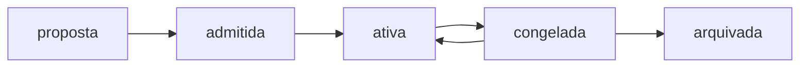

# Admissão de camadas — YBY SEED

**Documento canônico.** Regula como uma camada entra, cresce, congela ou sai do repositório. Não substitui D1–D15 ([DECISIONS.md](../DECISIONS.md)); em conflito, a decisão vigente prevalece e esta política deve ser corrigida.

**Base da classificação:** `main` @ `dbf3ce3` (2026-11-26).

## 1. Escopo e autoridade

- Vale para **toda camada nova** e para **toda expansão** de camada existente: módulo em `src/`, config em `config/`, script em `scripts/`, comando CLI, dependência opcional (`requirements-*.txt`, extras do `pyproject.toml`) ou integração com o caminho do `ask`.
- **Decisor:** o dono do repositório. Agentes (Cursor, OpenCode ou o próprio YBY) **propõem**; nunca admitem, congelam, arquivam ou removem camada por conta própria.
- Correção de bug, correção de segurança, testes e documentação de uma camada já existente **não** exigem nova admissão, desde que não ampliem escopo.

## 2. Ficha de admissão (obrigatória)

Preenchida no PR ou na spec da camada **antes** do código. Sem ficha aceita pelo dono, a camada não entra.

As seis perguntas, nesta ordem:

1. **Qual problema real resolve?** Situação concreta do dono hoje, não capacidade hipotética.
2. **Qual é o menor escopo?** Menor entrega que já resolve o problema.
3. **Como será validado?** Critérios de aceite verificáveis e testes.
4. **O que fica fora?** Lista explícita do que a camada não faz nesta etapa.
5. **Quem decide?** Dono que aceita a ficha e o aceite final.
6. **Quando será removida ou arquivada?** Condição objetiva de saída.

Campos complementares:

| Campo | Exigência |
|---|---|
| Usuário e caso de uso | Quem usa, em que momento, com qual entrada e saída |
| Escopo mínimo | Arquivos/pastas tocados; o que não muda (núcleo `ask`, D5/D12) |
| Critérios de aceite | Verificáveis; distinguir aceite offline (CI) de aceite no PC Hub |
| Testes obrigatórios | Offline no CI, sem HTTP real, modelo, download ou segredo; cobrir sucesso e falha relevante |
| Riscos | Privacidade (D3/D12), custo de nuvem (D12), permissões (D10, [agent-policy](../config/agent-policy.yaml)), VRAM (D4), novas dependências |
| Dono/decisor | Nome ou papel; quem pode congelar |
| Critério de arquivamento | Condição da seção 5 que se aplica |

## 3. Estados

| Estado | Significado |
|---|---|
| `proposta` | Ficha aberta; nenhum código entra |
| `admitida` | Ficha aceita pelo dono; implementação no escopo mínimo |
| `ativa` | Aceite cumprido; em uso ou no caminho de uso |
| `congelada` | Permanece no disco; só correção, segurança, testes e docs |
| `arquivada` | Fora do caminho ativo, conforme `docs/archive/` e índice de docs; remoção só por decisão explícita |

`congelada → ativa` exige nova ficha (expansão).

## 4. Proibição de expansão sem aceite

- Nenhuma feature, módulo, dependência, comando CLI, serviço ou integração com o `ask` entra sem ficha aceita.
- Em camada `congelada`, só correção de bug, correção de segurança, testes e docs.
- Spec, pesquisa ([SOURCE_SURVEY.md](SOURCE_SURVEY.md)) ou roadmap **não** admitem código por si só.
- Uma camada por rodada; não acoplar duas admissões no mesmo PR.

## 5. Critérios de arquivamento

Recomenda-se arquivar quando ao menos um vale:

- sem caso de uso ativo ou sem dono;
- aceite não cumprido e sem plano para cumpri-lo;
- substituída por outra camada (sobreposição);
- sem testes nem chamadores no código.

Arquivar ou remover é decisão do dono, em rodada própria. Nunca é efeito colateral de outro PR.

## 6. Classificação das camadas existentes

Recomendações são **propostas** para decisão do dono; nesta rodada nada foi removido, movido ou congelado no código. Evidência: CLI `yby --help`, imports em `src/`, testes em `tests/` e docs citados.

### Frentes principais

| Frente | Estado | Valor atual | Pendência | Recomendação |
|---|---|---|---|---|
| **Núcleo** (`src/engine`, `safety`, `actions`, `memory`, `platform`, `security`; CLI `ask`/`run`/`gate`/`note`/`recall`/`route`/`hub`) | `ativa` | Caminho de produção v1; gates e CI | Smokes Ollama e OpenRouter no PC Hub ([checklist](../PROGRESS.md#checklist-de-aceite-do-núcleo-consolidado)) | **manter** |
| **Agente** (`src/agent_loop`, `config/agent-policy.yaml`; CLI `agent`) | `ativa` fora do `ask` | Loop P0 com teto de iterações e política de tools fail-closed | Canal local de aprovação para tools `manual`; itens P0 do [ROADMAP](../ROADMAP.md) sem conferência contra critérios | **manter**; expansão só com ficha |
| **Voz** (`src/voice`, D11; CLI `listen`, `ask --voice`; `requirements-voice.txt`) | `ativa` (opcional) | STT/TTS local | Sem smoke registrado em hardware real; sobreposição com `src/yby/audio` (D15) | **manter** |
| **RAG** (`src/rag`) | `congelada` (de fato) | Otimizações de contexto/cache; sem CLI nem chamadores em `src/` | Lacuna de cobertura A11 ([AUDIT-REPORT](AUDIT-REPORT.md)); testes só em `tests/rag/` | **congelar** |
| **Gateway** (`src/gateway`) | `congelada` (de fato) | FastAPI/MQTT; `auth` usado por `src/yby/app.py` e `src/yby/edge_sync` | Lacuna A11; fora do `ask` | **congelar** (arquivar quebraria edge sync D15) |
| **IoT** (`src/iot`, [IOT.md](IOT.md), `requirements-iot.txt`) | `congelada` (de fato) | MQTT com backoff e anti-flood (#115); sem CLI nem chamadores | Sem aceite no hub; sem broker validado | **congelar** |
| **Glass** (`src/yby/glass`, `scripts/glass_sim.py`, [YBY_GLASS_SPEC](YBY_GLASS_SPEC.md)) | `ativa` em G1 (só simulador) | Contrato offline de captura/HUD/tools | G1b+ exigem aprovação; sem hardware | **congelar em G1** |
| **OpenCode** (`opencode.json`, [OPENCODE_INTEGRATION](OPENCODE_INTEGRATION.md)) | `admitida` em O0 | Perfil de engenharia versionado e testado; não é runtime | O1: humano confirma versão e faz sessão só leitura | **congelar em O0** |
| **Pesquisa** ([SOURCE_SURVEY](SOURCE_SURVEY.md)) | `ativa` (registro) | 31 fontes úteis rastreáveis | Meta 300 não concluída | **manter o registro**; congelar a meta 300; nova rodada só vinculada a camada admitida |

### Outras frentes no disco

| Frente | Estado | Valor atual | Pendência | Recomendação |
|---|---|---|---|---|
| **Visão** (`src/vision`, D14, `requirements-vision.txt`) | `congelada` (de fato) | Cliente FUSION/plano B; sem CLI | Validação pt-BR (D14); único skip da suíte (Pillow) | **congelar** |
| **Malha D15** (`src/yby/routing`, `src/yby/audio`, `src/yby/edge_sync`, `src/yby/app.py`; `requirements-mesh.txt`) | `admitida` (D15) | Contratos e roteamento com `PrivacyGate`; testes em `tests/yby/` | Sem aceite em hardware/serviços reais; sobreposição de áudio com `src/voice` | **congelar** |
| **yby_machine** (`src/yby_machine`; CLI `machine`) | `ativa` (CLI) | Gerador PWA offline Spec-First (#142) | Sem ficha de admissão nem aceite de uso registrado | **manter**; expansão só com ficha |
| **Evo** (`src/evo`; CLI `evo`) | `ativa` (CLI) | Relatórios locais de observabilidade (só leitura) | — | **manter** |
| **Agentes legados** (`src/agents`, `src/core`) | `congelada` (de fato) | Router/Planning/Execution/Validation com testes `tests/test_*_agent.py`; `src/core` só usado por eles | Sobreposição com `src/agent_loop`; fora do `ask` | **arquivar (candidato)** — decisão do dono |
| **Skills** (`src/skills`, `skills/`) | `congelada` (de fato) | Dry-run D6 com testes `tests/test_skills_*.py` | Sem integração ao agente | **congelar** |
| **Evaluation** (`src/evaluation`) | `congelada` (de fato) | Coberto em `tests/test_deep_scan_regressions.py` | Sem chamadores em `src/` | **congelar** |
| **Monitoring** (`src/monitoring`) | `congelada` (de fato) | — | Sem testes nem chamadores em `src/`, `scripts/` ou `tests/` | **arquivar (candidato)** — decisão do dono |

### Sobreposições e riscos observados

- **Áudio:** `src/voice` (D11) e `src/yby/audio` (D15) cobrem voz; a fronteira deve constar na ficha de qualquer expansão de uma delas.
- **Agentes:** `src/agents` + `src/core` e `src/agent_loop`; só `agent_loop` está na CLI.
- **Gateway ↔ malha:** `src/yby` depende de `src/gateway/auth.py`; congelar o gateway não pode quebrar esse contrato.
- **Edição por agente:** o perfil OpenCode permite editar `docs/*`, inclusive esta política; mudanças nela seguem a mesma revisão do dono.
