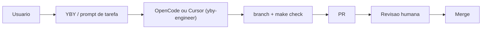

# OpenCode no YBY — ferramenta de engenharia (spec canônica O0)

**Status:** O0 — config versionada + testes offline. OpenCode **não** instalado nem executado nesta camada; nenhum provedor conectado.
**Config:** [`opencode.json`](../opencode.json) · **Testes:** [`tests/test_opencode_config.py`](../tests/test_opencode_config.py) · **Fontes:** [SOURCE_SURVEY.md](SOURCE_SURVEY.md) rodada 4.

## a) Objetivo

O OpenCode (agente de código terminal-first, MIT) é uma **ferramenta opcional de desenvolvimento** do repositório `yby-seed`, no mesmo papel do Cursor: editar em branch, rodar gates, preparar PR. **Não é runtime do YBY.** Nada em `src/` importa, chama ou configura o OpenCode; `yby ask`/`run`/`agent` continuam com `src/engine`, `src/agent_loop` e `src/safety` (D12).

## b) Escopo

| Permitido | Proibido |
|-----------|----------|
| Ler o repositório; editar `src/`, `tests/`, `docs/` | Integrar OpenCode ao runtime, engine, agent loop, safety ou CI |
| Rodar `make check`/`doctor`/`lint`/`test`, `pytest`, `ruff check`, `git status`, `git diff --check` | Push, merge, rebase, reset, clean, stash, checkout destrutivo |
| Propor diff para revisão humana | Instalar dependências, deploy, systemd, Docker, rede externa por shell |
| | Ler/editar `.env`, chaves, credenciais, `.git/config` |
| | Editar `AGENTS.md`, regras, CI, `Makefile`, dependências, a própria config |
| | MCP, plugins, skills e subagentes (negados por padrão) |

## c) Fluxo

O OpenCode termina em diff local verificado. Commit fica em `ask`; push, PR e merge ficam **fora** dele (negados) e seguem a **Autorização** do `AGENTS.md`, feitos pelo humano ou pelo agente Cursor.

## d) Perfil `yby-engineer`

Em `opencode.json`: `agents.yby-engineer` com `mode: "primary"` e `default_agent: "yby-engineer"`. Sem `system` (não substitui o prompt base), sem `model` (escolha do usuário, sob D12). As permissões ficam em `permissions` de topo, que valem para **todos** os agentes, inclusive os embutidos (`build`, `plan`, `general`, `explore`).

## e) Permissões

Formato V2: lista ordenada `{action, resource, effect}`; **a última regra que casa vence**; sem regra, `ask`. O padrão embutido é permissivo (`* * allow`), por isso a config começa restringindo.

| Ação | Regra efetiva |
|------|---------------|
| `external_directory` | `deny` — nada fora do repositório |
| `read`, `glob`, `grep` | `allow` no repositório; `read` `deny` para `*.env`, `*.env.*`, `.git/*`, `*.pem`, `*.key`, `*id_rsa*`, `*id_ed25519*`, `*.ssh/*`, `*credential*`, `*secret*`; `*.env.example` `allow` |
| `edit` | `deny` geral; `allow` em `src/*`, `tests/*`, `docs/*`; `ask` em `src/safety/*`, `src/security/*`, `src/actions/*`; `deny` para `*.env*`, chaves e segredos |
| `shell` | `ask` por padrão; `allow` só para gates (seção g); `deny` para a lista proibida |
| `subagent` | `deny` |
| `webfetch`, `websearch` | `ask` |
| MCP / plugins / skills | `deny` via `policies` (`mcp.use`, `plugin.use`, `skill.use`) |

Nenhuma regra `allow` usa `shell *`, `edit *` ou `action: *` (teste c).

## f) Políticas permanentes

`policies` com `tool.use` são bloqueio rígido: aplicam-se depois das regras e das aprovações salvas ("Allow always") e nunca concedem acesso. Cobrem: `git push`, `git merge`, `git reset`, `git clean`, `git stash`, `sudo`, `pip`, edição de `*.env*`, leitura de `*.env` e `.git/*`, e qualquer subagente.

- **Segredos:** nunca ler, imprimir nem versionar; a config não usa substituição de variável de ambiente nem de arquivo e não tem `providers` (teste h).
- **Deploy/push/merge:** fora da ferramenta; seguem `AGENTS.md`.
- **Dependências:** instalação negada; dependência nova exige aprovação explícita (`AGENTS.md`).
- **Regras de segurança:** `AGENTS.md`, `.cursor/rules`, CI, `Makefile`, `config/safety-allowlist.txt` e `opencode.json` não são editáveis pelo perfil; `src/safety`, `src/security`, `src/actions` exigem aprovação a cada edição.

## g) Comandos

**Allow:** `make check`, `make doctor`, `make lint`, `make test` (exatos); `pytest *`, `python -m pytest *`, `python3 -m pytest *`, `.venv/bin/python -m pytest *`; `ruff check *` e as mesmas variantes `-m`; `git status *`; `git diff --check *`.

**Deny:** `ruff` com `--fix`/`--unsafe-fixes`; `git push|merge|rebase|reset|clean|restore|stash|filter-branch|filter-repo|update-ref|gc|prune`, `git reflog expire`, `git checkout -- / -f / . / --force`, `git switch -f / --force / --discard-changes`, `git branch -D`; `pip`, `pip3`, `python -m pip`, `.venv/bin/pip`, `pipx`, `uv add|pip|sync|tool`, `uvx`, `poetry`, `conda`, `npm`, `npx`, `pnpm`, `yarn`, `bun`, `bunx`, `apt`, `apt-get`, `brew`, `cargo install`, `go install`; `make setup|install-dev|clean|qdrant-*`; `sudo`, `su`, `curl`, `wget`, `docker`, `docker-compose`, `podman`, `systemctl`, `service`, `*install-hub-service*`, `vercel`, `gh`, `ssh`, `scp`, `rsync`, `nc`; `rm -r*`, `rm -f*`, `rm --recursive*`, `rm --force*`; `opencode`, `ollama`, `printenv`, `env`; comandos que citem `.env`, `.git/config`, `.git-credentials`, `.ssh/`, `id_rsa`, `.pem`.

**Ask (demais):** ex.: `ls`, `git diff`, `git commit`, `ruff format`, `yby ask`.

## h) Instruções: reutilizar, não duplicar

O OpenCode carrega o `AGENTS.md` da raiz automaticamente. A config só acrescenta `instructions: [".cursor/rules/yby.mdc", ".cursor/rules/yby-economy.mdc"]` (caminhos locais existentes; sem URL). Esta spec não repete regras de autorização, escopo ou gates: a fonte é o `AGENTS.md`.

## i) MCP

Desativado: sem bloco `mcp` e `mcp.use *` negado por policy (remoto e local). Para avaliar um servidor **local** no futuro (camada própria, com aprovação): licença compatível; código auditável e versão fixa; comando fixo sem download em tempo de execução; sem rede e sem segredos; entrada com `disabled: true` até aprovação; exceção `mcp.use` nominal; permissões por ferramenta (`<servidor>_*`) começando em `deny`. MCP remoto: fora de escopo.

## j) Testes e validação

`tests/test_opencode_config.py` (stdlib + pytest, offline) replica a semântica documentada (curingas `*`/`?` sobre o valor inteiro; padrão de shell terminado em ` *` casa o comando sem argumentos; base → topo → agente, última vence; `tool.use` deny por último) e cobre:

- **a)** JSON válido, chaves V2 conhecidas e sem chaves V1 obsoletas.
- **b)** O perfil existe e é o padrão.
- **c)** Sem `allow` amplo.
- **d)** Os gates permitidos.
- **e)** Comandos destrutivos, de instalação e de deploy negados.
- **f)** Segredos e `.env` negados.
- **g)** MCP, plugins, skills e subagentes negados.
- **h)** Nenhuma credencial na config ou na spec, e nenhum `.env` versionado.
- **i)** `src/` sem menção a OpenCode, e governança não editável.

Validação extra, manual e não versionada: em 2026-11-26 o `opencode.json` foi validado contra o schema publicado `https://opencode.ai/config.json`, com 0 erros.

## k) Riscos, limites e aceite

**Riscos e limites:**

- **Precedência:** uma config global (`~/.config/opencode`), de sistema ou do Console pode sobrepor a do projeto, inclusive policies. A config do repositório é um padrão seguro, não um enforcement organizacional.
- **Versão:** o formato V2 (`permissions`, `agents`) e as policies `mcp.use`/`plugin.use`/`skill.use` exigem OpenCode ≥ 2.2.3. Um cliente antigo pode ignorá-las e cair no padrão permissivo. A versão não foi verificada nesta camada.
- **Scanner de shell:** é "best effort". Formas indiretas (`git -C . push`, `bash -c "..."`, aliases, scripts) podem escapar dos padrões ou cair em `ask`. Na dúvida, rejeite.
- **`grep`:** o recurso é a regex, não o caminho, então `.env` não é bloqueável nele por path. Não foi verificado se respeita `.gitignore`.
- **`pytest` executa código do repositório**, que é aceitável para código revisado em branch.
- **Provedor e modelo:** não configurados, ficam a cargo do usuário sob D12 (local-first, sem fallback automático para nuvem). Esta spec não promete modelo nem provedor.
- **Aprovações salvas ("Allow always")** viram `allow` no projeto. Revise-as periodicamente. Os `deny` e as policies continuam valendo.

**Aceite O0:** config válida no schema; testes da seção j verdes; `make check` verde; nenhum arquivo do runtime, CI, `Makefile` ou dependências alterado; nenhum segredo versionado.

## l) Roadmap (camadas pequenas; todas futuras exigem aprovação)

| Camada | Conteúdo | Estado |
|--------|----------|--------|
| O0 | Esta spec + `opencode.json` + testes offline | concluída (#152) |
| O1 | Humano confirma `opencode --version` ≥ 2.2.3 e faz uma sessão só leitura, sem provedor de nuvem; confere os `deny` na prática | futuro |
| O2 | Uma tarefa de docs/testes via OpenCode até `make check` verde, com push/PR fora dele | futuro |
| O3 | Avaliar `policies` `provider.use` alinhadas a D12 | futuro |
| O4 | Avaliar um MCP local específico pelos critérios da seção i | futuro |
