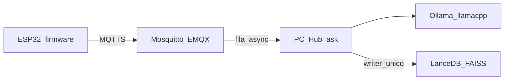

# Benchmark OSS Local-First × YBY SEED

> **Docs-only.** Padrões e anti-patterns de projetos MIT/Apache/BSD alinhados à visão YBY (edge local-first, ESP32, hub híbrido).  
> **Não** mergear forks de terceiros neste repositório (**D7**). Wearable/gateway MQTT ficam **pós-v1**; o hub atual já mitiga vários riscos via **D1 / D4 / D10 / D12**.

**Licenças admitidas para referência:** MIT, Apache-2.0, BSD-3-Clause (e EDL/Eclipse Distribution License onde equivalente a BSD).  
**Excluir** AGPL/GPL como fonte de *merge* (ex.: ESPHome runtime GPLv3 — só ideias de config; já notado no plano wearable).

**Nota de verdade operacional:** [`docs/ARCHITECTURE.md`](../ARCHITECTURE.md) descreve um desenho aspiracional (gateway+agentes+7B). A verdade do v1 é [`docs/REPOS.md`](../REPOS.md) + **D4** (`qwen2.5-coder:3b`) + [`docs/DEV.md`](../DEV.md).

---

## 1. Gateways IoT + concorrência IA (FastAPI / MQTT / Vector DB)

### Referências permissivas

| Projeto | Licença | Papel |
|---|---|---|
| [eclipse/mosquitto](https://github.com/eclipse/mosquitto) | EDL/EPL | Broker MQTT maduro; TLS nativo |
| [emqx/emqx](https://github.com/emqx/emqx) | Apache-2.0 | Broker alto throughput; pool de conexões (PR #10754: ecpool; **subscribe ainda single-worker** para não duplicar ingress) |
| [lancedb/lancedb](https://github.com/lancedb/lancedb) | Apache-2.0 | Vector DB embedded mmap |
| [facebookresearch/faiss](https://github.com/facebookresearch/faiss) | MIT | Similarity search C++/Python |
| [papajo/local-rag](https://github.com/papajo/local-rag) | MIT | FastAPI + LanceDB local; ingest incremental por hash SHA-256 |
| [4alvit/fastapi-mqtt-gateway](https://github.com/4alvit/fastapi-mqtt-gateway) | MIT | Bridge REST/WS→MQTT + JWT + rate limit (projeto pequeno; padrão, não “consolidadíssimo”) |

### Padrões a adaptar (não o monólito)

1. **Separar ingestão MQTT de RAG/LLM**  
   Worker MQTT → fila bounded (`asyncio.Queue` com `maxsize`) → consumidor único. Nunca embeddar/search no callback MQTT no mesmo thread do event loop.
2. **CPU-bound (embed/LLM) fora do loop**  
   `run_in_executor` com **pool de 1 worker** para modelos que já usam threads internas (evita CPU thrashing — padrão documentado em serving FastAPI+SBERT). I/O vetorial async ou sync-no-executor.
3. **Um writer LanceDB**  
   Fan-out de embeddings, fan-in para um único processo/tarefa de escrita em batches (issue LanceDB #213). Evitar N processos abrindo a mesma tabela.
4. **Backpressure**  
   Fila cheia → drop QoS0 / nack / métrica; não crescer Redis/Celery sem limite (anti-pattern Qdrant+Celery guides).

### Race conditions / bugs crônicos a evitar

| Anti-pattern | Sintoma | Mitigação YBY |
|---|---|---|
| Sync client vetorial em `async def` | Event loop congelado; latência p99 sobe sem erro | Gateway legado fora do `ask` (D1); futuro: executor ou client async |
| N writers LanceDB / `mergeInsert` stale handle | Duplicatas silenciosas (issue #3377 JS path) | Writer único + `checkoutLatest` se multi-handle |
| MQTT bridge com pool que também subscribe N× | Mensagens duplicadas `pool_size` vezes | Ingress single-subscriber (lição EMQX) |
| Embedding no mesmo processo Uvicorn sem fila | Thread pool default (40) esgota sob burst sensor | Fila + worker dedicado; hub atual não faz RAG no hot path |
| Retry cego após timeout de write | Append duplicado (Lance OCC: timeout ≠ falha) | Idempotency key / check-before-retry |

**YBY já mitiga:** PC Hub primeiro (D1); `src/gateway` legado **fora** do `ask`; vault Markdown sem vector write concorrente no caminho crítico; D10 não executa shell a partir de MQTT cru.

### Checklist — não fazer (gateway/RAG)

- [ ] Não rodar embed/LLM no callback MQTT.
- [ ] Não abrir a mesma tabela LanceDB/FAISS com N writers.
- [ ] Não expor MQTT 1883 na WAN sem TLS + ACL.
- [ ] Não usar Celery/Redis “infinito” sem backpressure medido.
- [ ] Não copiar o monólito de um gateway jovem como dependência runtime.

---

## 2. Firmware ESP32 + MQTTS + TLS/ECDSA + energia

### Referências

| Projeto | Licença | Papel |
|---|---|---|
| [espressif/esp-idf](https://github.com/espressif/esp-idf) + [esp-mqtt](https://github.com/espressif/esp-mqtt) | Apache-2.0 | Cliente MQTT oficial; TLS; auto-reconnect; stack configurável |
| [kmwebnet/ECC608-mqtts-client](https://github.com/kmwebnet/ECC608-mqtts-client) | MIT | MQTTS + ATECC608A (ECDSA/ECDH em secure element) + BME280 |
| ESP-IDF mbedtls component | Apache-2.0 (fork Espressif) | ECDSA/ECDH; `CONFIG_MBEDTLS_DYNAMIC_BUFFER` corta heap TLS ~42KB→22KB |

### Padrões a adaptar (FRANK_ZER0 / YBY wearable — pós-v1)

1. Preferir **esp-mqtt** (event loop FreeRTOS) a PubSubClient+WiFiClientSecure reinventado.
2. `CONFIG_MQTT_TASK_STACK_SIZE` ≥ 8192 com TLS (default 6144 estoura com mbedTLS).
3. Certificados: `setCACert` / bundle estático; **não** `loadCACert(Stream)` a cada deep-sleep (leak documentado arduino-esp32 #9636 — heap cai ~tamanho do PEM por ciclo).
4. Destruir TLS client / `stop()` em falha de handshake (leak histórico #5945).
5. Deep sleep: **não** chamar flash/NVS/sleep a partir do MQTT task se stack está em PSRAM (`CONFIG_MQTT_TASK_STACK_ON_EXTERNAL_MEMORY` — docs oficiais).
6. `client_id` único por device; colisão = disconnect loop + WDT (esp-idf #3254).
7. Energia: wake → WiFi → MQTT publish curto QoS0/1 → disconnect limpo → deep sleep; backoff exponencial em reconnect (`reconnect_timeout_ms`).
8. **Sem Tailscale no ESP32** — VPN só no hub (plano wearable / D1).

### Bugs de stack / heap mais frequentes

| Bug | Causa | Prevenção |
|---|---|---|
| Stack overflow no `mqtt_task` | TLS + JSON grande + stack 6KB | Subir stack; buffers MQTT em PSRAM com cuidado |
| Heap fragmenta até SSL alloc fail (-32512) | Recriar WiFiClientSecure + loadCACert por sleep | Cert em RO data; um alloc |
| WDT no mqtt_task | Bloqueio longo / duplicate client_id | Watchdog feed; IDs únicos; evitar trabalho pesado no event handler MQTT |
| Brownout em TX WiFi + sensor | Pico de corrente | Medir; capacitor; separar duty cycle rádio/sensor |

**YBY já mitiga:** firmware **fora do seed** (D1/D7); plano wearable já exige MQTT/TLS até o hub; métricas heap em [`METRICAS_OBSERVABILIDADE.md`](METRICAS_OBSERVABILIDADE.md).

### Checklist — não fazer (firmware)

- [ ] Não colocar firmware T-Watch dentro de `yby-seed`.
- [ ] Não recarregar CA PEM a cada ciclo de deep-sleep.
- [ ] Não dormir a partir da task MQTT com stack em PSRAM.
- [ ] Não reutilizar o mesmo `client_id` em dois devices.
- [ ] Não instalar Tailscale no ESP32.

---

## 3. Edge AI em 4GB VRAM / 16GB RAM

### Referências

| Projeto | Licença | Papel |
|---|---|---|
| [ggml-org/llama.cpp](https://github.com/ggml-org/llama.cpp) | MIT | GGUF, `-ngl` offload, KV quant |
| [ollama/ollama](https://github.com/ollama/ollama) | MIT | Wrapper llama.cpp; API local |
| FAISS | MIT | Índices compactos CPU; evitar GPU FAISS no 1650 compartilhada com LLM |

### Estratégias superiores (aplicáveis ao Hub)

1. **Modelo ≤3B Q4_K_M** cabe ~100% VRAM — alinhado a **D4** (`qwen2.5-coder:3b`). 7B Q4 (~4.1GB) força offload; em Ryzen moderno, CPU-only 7B muitas vezes **mais rápido** que partial offload 10 layers na 1650 (4–10 tok/s vs 7–15 CPU).
2. **Capar contexto** (`num_ctx` 2048–4096) — default alto OOMa. Ver `YBY_OLLAMA_NUM_CTX` em DEV.
3. **KV cache q8_0** — dobra contexto útil sem qualidade perceptível.
4. **Não** rodar visão+texto no mesmo processo Ollama sem orquestração: serializar jobs (fila); um modelo residente.
5. jemalloc/mimalloc ajudam **heap host** (fragmentação), **não** VRAM; OOM Vulkan (`GGML_VK_FORCE_MAX_ALLOCATION_SIZE`) é bug de driver/alloc >~4GB — irrelevante se D4 for respeitado.
6. Regressões Ollama 0.30.x Vulkan OOM em GGUF grandes (#16564) — pin versão / testar upgrade no Hub.
7. **Nuvem:** falha Ollama no caminho local **não** dispara OpenRouter (D12 / fase P); teto OpenRouter **US$10/mês** (política dono / #42).

**YBY já mitiga:** D4 único 3B; D12 local-first; cascade Ollama→nuvem removido no caminho local; `YBY_OLLAMA_NUM_CTX` documentado em DEV.

### Checklist — não fazer (edge AI)

- [ ] Não adotar 7B+ na 1650 4GB como default do hub.
- [ ] Não deixar `num_ctx` ilimitado / default de servidor.
- [ ] Não colocar FAISS-GPU no mesmo processo que o LLM na 1650.
- [ ] Não fazer failover automático OpenRouter→Grok (D12 / #42).

---

## 4. Matriz de reutilização e prevenção

| Projeto (licença) | Adaptar | Bug/gargalo histórico | YBY mitiga por |
|---|---|---|---|
| **Mosquitto** (EDL) | Broker local TLS; ACL por device | Expor 1883 na WAN | Broker só LAN/Tailscale no hub (plano wearable) |
| **EMQX** (Apache-2.0) | Pool egress; single ingress subscriber | Duplicar msgs se pool também subscribe | Ingress 1:1 na bridge futura |
| **LanceDB** (Apache-2.0) | mmap local; batch writes | Multi-writer / mergeInsert duplicatas | Writer único; RAG legado fora do `ask` |
| **FAISS** (MIT) | Index CPU Flat/IVF para recall local | GPU FAISS + LLM = OOM 4GB | Sem FAISS-GPU no hub |
| **local-rag** (MIT) | Ingest hash-incremental SQLite state | Reindex full a cada boot | Padrão para evoluir vault depois da Fase P |
| **esp-mqtt / ESP-IDF** (Apache-2.0) | Auto-reconnect; stack TLS; dynamic mbedtls buffers | Stack 6KB; sleep from MQTT-on-PSRAM | Checklist firmware futuro + métricas heap |
| **ECC608-mqtts** (MIT) | Secure element ECDSA | Complexidade I2C + provisão | Só se wearable exigir HSM; senão bundle PEM |
| **llama.cpp / Ollama** (MIT) | GGUF Q4; ngl; KV q8 | Offload 7B lento; Vulkan OOM | D4 3B; ctx limitado |
| **fastapi-mqtt-gateway** (MIT) | JWT + rate limit no bridge | Projeto jovem / pouco battle-tested | Copiar *padrão*, não depender do repo |

---

## Relação com outros docs future

| Doc | Uso |
|---|---|
| [`PLANO_ECOSISTEMA_WEARABLE.md`](PLANO_ECOSISTEMA_WEARABLE.md) | Arquitetura hub↔watch; este benchmark alimenta decisões MQTT/TLS/energia |
| [`METRICAS_OBSERVABILIDADE.md`](METRICAS_OBSERVABILIDADE.md) | Heap/stack/fila — validar mitigações acima |
| [`FICHA_INVESTIGACAO.md`](FICHA_INVESTIGACAO.md) | Quando um bug de firmware/hub aparecer de verdade |
| [`EVO_NIGHT_WATCH.md`](EVO_NIGHT_WATCH.md) | Auto-evolução **supervisionada** — não reescreve stack MQTT |

---

## Fora de escopo deste documento

- Alterar `src/engine`, gateway legado ou firmware.
- Absorver código de repos listados (D7).
- Definir PCB rev / GPS / Xiaomi (ficha hardware).
- Subir teto OpenRouter acima de US$10/mês.
