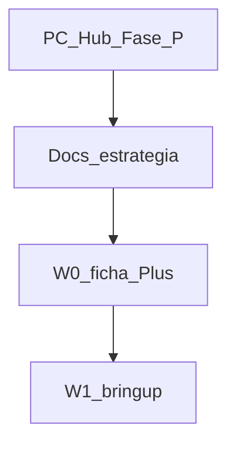

# Estratégia mestre YBY ZERO → Wearable

> **Docs-only.** Hub PC primeiro; T-Watch **S3 Plus** depois; firmware **fora** do `yby-seed` (D1/D7).  
> **Princípio:** FUNCTION OVER FORM · local-first · hipótese ≠ fato.  
> **Rótulos de evidência:** **Fato** | **Relato** | **Hipótese** | **Medido-terceiros** | **Conflito** | **Não decidível**.

Irmãos: [PLANO_ECOSISTEMA_WEARABLE.md](PLANO_ECOSISTEMA_WEARABLE.md) · [METRICAS_OBSERVABILIDADE.md](METRICAS_OBSERVABILIDADE.md) · [FICHA_INVESTIGACAO.md](FICHA_INVESTIGACAO.md) · [EVO_NIGHT_WATCH.md](EVO_NIGHT_WATCH.md) · [BENCHMARK_OSS_LOCAL_FIRST.md](BENCHMARK_OSS_LOCAL_FIRST.md) (quando merged) · scan Plus em PR #81 / `SCAN_TWATCH_S3_PLUS.md`.

---

## Navegação do produto (relógio) — FUNCTION OVER FORM

| Camada | Conteúdo |
|---|---|
| **Topo relógio** | ≤5 itens: status / alerta / confirmar / voz / métricas |
| **Drill-down** | Funções extras **só** sob esses 5 — nunca menu flat com dezenas de botões |
| **Voz** | Intents curtos → hub (STT no PC); relógio não roda LLM |
| **Microgestos** | 2–3 eventos calibrados (`confirm` / `back` / `voice`) — discretos, não gestos complexos |

---

## 1. Sumário

| Afirmação | Rótulo |
|---|---|
| v1 do seed = PC Hub CLI local-first (`ask`, safety, vault, voz, hub) | **Fato** ([ROADMAP.md](../../ROADMAP.md), [docs/REPOS.md](../REPOS.md)) |
| Maturidade hub v1 ~68–74% (main vs PRs FinOps abertos) | **Hipótese** de engenharia — ver análise de maturidade se publicada |
| Wearable / mobile **fora** do v1 seed | **Fato** (D1, [FORA-DO-V1.md](../archive/FORA-DO-V1.md)) |
| Nuvem: D12 + teto OpenRouter US$10/mês (política dono) | **Fato** (decisões + `.env` / #42) |
| Ordem: fechar Fase P no hub **antes** de W1 bring-up no relógio | **Fato** deste plano |

---

## 2. Estado atual

| Camada | Estado | Onde |
|---|---|---|
| `yby ask` + Ollama 3B (D4) | Feito | `src/engine` |
| Safety / `run` / allowlist (D10) | Feito | `src/safety`, `src/actions` |
| Vault `note`/`recall` (D8) | Feito | `src/memory` |
| Voz Whisper+Piper (D11) | Feito (deps opcionais) | `src/voice` |
| Hub systemd keepalive (D9) | Código feito; aceite no Hub físico = checklist | `src/platform`, Fase P |
| FinOps nuvem #42 | Parcial em `main`; S1–S3/WAL em PRs abertos | `CLOUD_USAGE_SPEC` |
| `yby agent` P0 | Opt-in; fora do `ask` | `src/agent_loop` |
| RAG / gateway / agents stubs | Disco; fora do `ask` | `src/rag`, `src/gateway`, `src/agents` |
| Firmware T-Watch Plus | **Fora** da árvore | YBY / FRANK_ZER0 |
| Orquestração LangGraph | Repo separado | yby-core (D7) |

---

## 3. Inventário de fontes

| Fonte | Tipo | Uso |
|---|---|---|
| [LilyGoLib](https://github.com/Xinyuan-LilyGO/LilyGoLib) | Oficial MIT | Board init **Plus** |
| Wiki / quick start LilyGO T-Watch S3 Plus | Oficial | LVGL/IDF — **confirmar** versão antes de codificar |
| ESP-IDF + esp-mqtt | Apache-2.0 | MQTTS, TLS, reconnect |
| [PLANO_ECOSISTEMA_WEARABLE.md](PLANO_ECOSISTEMA_WEARABLE.md) | Interno | Arquitetura hub↔watch |
| SCAN T-Watch S3 Plus (PR #81) | Interno | Inventário técnico Plus |
| [BENCHMARK_OSS_LOCAL_FIRST.md](BENCHMARK_OSS_LOCAL_FIRST.md) | Interno | Anti-patterns MQTT/TLS/edge |
| Issues LilyGO / arduino-esp32 / esp-idf | Comunitário | Sempre marcar variante |

**Não usar stars** como evidência de qualidade.

---

## 4. Problemas confirmados (só com evidência no seed ou SCAN)

| Item | Rótulo | Nota |
|---|---|---|
| Confundir T-Watch S3 / 2020 / Plus quebra pinout | **Fato** (política do repo) | Ficha exige variante |
| Cascade Ollama→nuvem no caminho local era bug; corrigido D12 | **Fato** (#80) | Hub |
| Docs aspiracionais (ARCHITECTURE 7B) ≠ runtime D4 3B | **Fato** | Preferir REPOS/DEV |
| PCB rev Plus neste seed | **Não decidível** | Sempre `desconhecida` até ficha |

---

## 5. Hipóteses (não promover a fato)

| Item | Rótulo | Como invalidar |
|---|---|---|
| LVGL v8 no Plus (wiki) vs docs LilyGO antigos em v7 | **Conflito** / **Hipótese** | Ler quick start da revisão medida |
| Coexistência Wi-Fi+BLE causa heap/WDT | **Relato** comunitário | Ficha + IDF advisory + coredump |
| HyperOS Doze mata gateway no Xiaomi | **Hipótese** | Teste com ficha Android |
| Correntes LilyGO **S3** aplicam à Plus | **Não** | Extrapolação proibida |

---

## 6. Medições de terceiros

| Métrica | Escopo | Rótulo |
|---|---|---|
| Correntes / mA publicados LilyGO para **S3** (não Plus) | Outra variante | **Medido-terceiros** — **não** copiar como meta Plus |
| Heap TLS mbedTLS / stack MQTT 6KB | ESP-IDF genérico | **Medido-terceiros** / **Relato** — validar na Plus |
| Plus: mA active/sleep, FPS LVGL, brownout | Hardware dono | **Não decidível** até W0–W1 |

---

## 7–15. Gargalos e riscos por domínio

Formato: evidência · impacto · teste · doc.

### 7. Energia

| Evidência | Impacto | Teste | Doc |
|---|---|---|---|
| **Hipótese:** display+PMIC dominam consumo vs SoC sozinho | Autonomia | Medir placa completa (METRICAS) | METRICAS, ficha |
| **Medido-terceiros:** S3 ≠ Plus | Planejamento errado se misturar | Só Plus no banco | FICHA variante |

### 8. Memória (heap / PSRAM)

| Evidência | Impacto | Teste | Doc |
|---|---|---|---|
| **Relato:** stack MQTT+TLS 6KB estoura | WDT / crash | Stack ≥8KB; watermark | BENCHMARK, SCAN |
| **Relato:** reload CA a cada sleep | Fragmentação heap | Cert em RO; um alloc | BENCHMARK |

### 9. Rádio (Wi-Fi / BLE / SX1262?)

| Evidência | Impacto | Teste | Doc |
|---|---|---|---|
| **Não decidível:** SX1262 no MVP | Escopo W1 | Pergunta ao dono (§25) | Esta seção |
| **Hipótese:** scan BLE + Wi-Fi TX | Brownout | Duty cycle separado | PLANO §6 |

### 10. UI / LVGL

| Evidência | Impacto | Teste | Doc |
|---|---|---|---|
| **Conflito:** v7 docs vs v8 wiki | API errada | Confirmar na rev medida | PLANO §6 |
| Mega-menu flat | UX ruim / RAM | Topo ≤5 + drill-down | Navegação acima |

### 11. Android / HyperOS (Xiaomi)

| Evidência | Impacto | Teste | Doc |
|---|---|---|---|
| **Hipótese:** Doze mata processo | Cache offline some | Ficha Android + adb | MOBILE_FUTURE |
| Papel: BLE provision / notif — **não** LLM | Escopo claro | — | PLANO §4 |

### 12. Rede / Tailscale

| Evidência | Impacto | Teste | Doc |
|---|---|---|---|
| **Fato (política):** Tailscale **só** PC/telefone; **não** no ESP32 | Segurança / flash | Checklist W1 | PLANO §5, D1 |
| MQTT/TLS até o hub | Path crítico | Mosquitto LAN | BENCHMARK |

### 13. Segurança

| Evidência | Impacto | Teste | Doc |
|---|---|---|---|
| Intent → hub valida → firmware allowlist | Evita cloud→GPIO | Evo + D10 | EVO_NIGHT_WATCH |
| Sem OpenRouter no relógio | Vazamento / custo | Arquitetura | PLANO §3 |
| Authz vault antes de nuvem | Resto S4 #42 | Hub | CLOUD_USAGE_SPEC |

### 14. Gateway / protocolo

| Evidência | Impacto | Teste | Doc |
|---|---|---|---|
| JSON P0 → CBOR P1 | Bandwidth | Schema versionado | PLANO §4 |
| Idempotência de eventos | Duplicatas offline | IDs únicos | PLANO §4 |
| Ingress MQTT single-subscriber | Msgs duplicadas se pool | Lição EMQX | BENCHMARK |

### 15. Auto-evolução

| Evidência | Impacto | Teste | Doc |
|---|---|---|---|
| **Fato:** só Evo/Night Watch supervisionado | Sem rewrite livre | `make check` + aprovação | EVO_NIGHT_WATCH |
| **Proibido:** cloud→GPIO; merge automático | Segurança | Política | Esta seção |

---

## 16. Soluções possíveis (adaptar)

| Solução | Decisão |
|---|---|
| Mosquitto TLS no hub + esp-mqtt no Plus | **Usar** (pós-v1) |
| LilyGoLib MIT para board init | **Usar** após checklist variante |
| Voz/gestos → intents no hub | **Usar** |
| CBOR telemetria depois de JSON MVP | **Adaptar** |
| Secure element ECC608 | **Adiar** até HSM necessário |
| Insights / analytics **só local** no hub | **Adaptar** (nunca cloud Insights → device) |

---

## 17. Soluções descartadas

| Item | Por quê |
|---|---|
| LLM no relógio | RAM/energia; D4 no hub |
| Tailscale / VPN no ESP32 | Flash/complexidade; política D1 |
| ESPHome runtime no produto | GPLv3 — só ideias de config |
| Mega-menu LVGL flat | FUNCTION OVER FORM |
| Insights cloud → GPIO | Segurança; Evo supervisionado |
| Absorver YBY/yby-core/FRANK no seed | D7 |
| Tratar datasheet S3 como Plus | Variante errada |

---

## 18–19. Ferramentas e repos (matriz curta)

| Ferramenta | Licença | Função | RAM/risco | Decisão |
|---|---|---|---|---|
| ESP-IDF + esp-mqtt | Apache-2.0 | Firmware MQTTS | Stack TLS | **Usar** |
| PlatformIO | — | Build firmware (repo FRANK/YBY) | — | **Usar** fora do seed |
| LVGL | MIT | UI | Buffers/PSRAM | **Usar** após versão confirmada |
| heap/coredump IDF | — | Debug | — | **Usar** |
| Mosquitto | EDL | Broker hub | Expor WAN | **Usar** só LAN |
| MQTT JSON/CBOR | — | Telemetria | — | **Usar** |
| FastAPI `src/gateway` | MIT | Loopback legado | Token | **Adaptar** / adiar exposição |
| SQLite / FTS | — | FinOps / evo | Local | **Usar** no hub |
| Tailscale | — | Rede PC/Android | Não no ESP | **Usar** no hub |
| adb / Termux | — | Android debug | Bateria | **Usar depois** |
| Ollama + qwen 3B | MIT | IA hub | 4GB VRAM | **Usar** (D4) |

---

## 20–21. Testes e benchmarks obrigatórios

Herdar W0–W6 do plano wearable + [METRICAS_OBSERVABILIDADE.md](METRICAS_OBSERVABILIDADE.md):

| Marco | Conteúdo | Critério |
|---|---|---|
| **W0** | Ficha Plus: PCB rev, sintoma, fato/hipótese | Sem rev → não codificar pinout |
| **W1** | Bring-up: boot, Wi-Fi, MQTTS ao hub | Heap/stack watermark OK |
| **W2** | Energia: active / sleep / wake | mA medidos na **Plus** |
| **W3** | UI: FPS / flush / touch | Buffers parciais |
| **W4** | Offline queue + idempotência | Sem duplicar ações |
| **W5** | Segurança: allowlist intents | Sem cloud→GPIO |
| **W6** | Stress: reconnect, brownout, Doze Android | Fichas fechadas |

Hub em paralelo: `make check`, Fase P checklist, teto OpenRouter US$10.

---

## 22. Alterações nos docs YBY (esta entrega)

| Doc | Mudança |
|---|---|
| `docs/future/ESTRATEGIA_YBY_ZERO.md` | **Este arquivo** |
| `docs/future/README.md` | Link |
| `docs/future/FICHA_INVESTIGACAO.md` | Bloco **YBY-WATCH-001** |
| PLANO / SCAN / BENCHMARK / EVO | Referenciados; não reescritos aqui |

---

## 23. Plano de ação por prioridade

| Prioridade | Ação | Onde |
|---|---|---|
| **A** | Merge stack FinOps (#82→#87) + checklist Fase P no Hub físico | yby-seed |
| **B** | Preencher ficha **YBY-WATCH-001** (PCB / sintoma) | FICHA |
| **C** | W1–W6 bring-up | FRANK_ZER0 / YBY — **não** seed |
| **D** | Agente P0 evals no hub antes de UI rica no relógio | ROADMAP |

**Parar** se P0/evals do hub falharem — não abrir firmware pesado.

---

## 24. Não decidível ainda

- Revisão PCB da Plus (`desconhecida`).
- mA / autonomia reais da Plus.
- LVGL FPS real na revisão do dono.
- HyperOS Doze no Xiaomi 12 do dono.
- SX1262 / GPS no MVP.
- Papel exato do Xiaomi no caminho crítico.

---

## 25. Perguntas ao dono

1. Qual a **revisão PCB** impressa na Plus (ou foto)?
2. Rádio **SX1262** entra no MVP ou fica fora?
3. **GPS** ligado no MVP ou só telemetria básica?
4. Xiaomi 12 é **crítico** no path ou só provisioning/notif?

Até responder: PCB = `desconhecida`; sem pinout inventado; sem Tailscale no ESP; menu ≤5 + voz/gestos.

---

## Explicitamente fora deste documento

- Implementar menu LVGL, firmware, PlatformIO no seed.
- “Acatar melhorias da internet” sem métrica/ficha.
- Declarar consumo de outra variante como fato Plus.
- Auto-limpeza mágica sem allowlist / aprovação humana.
