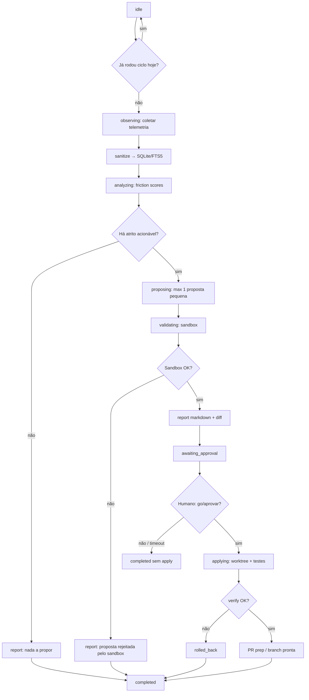
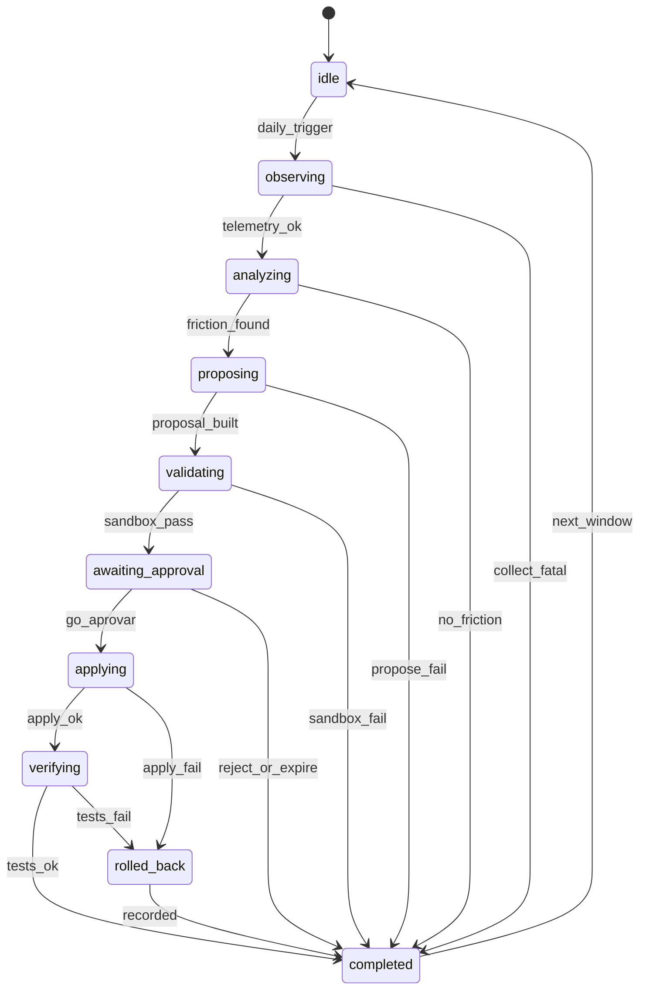

# Evo / Night Watch — arquitetura de auto-evolução supervisionada

> **Status:** design only (sem implementação de produto neste documento).  
> **Público:** arquiteto / dono do seed.  
> **Princípio:** observação → diagnóstico → hipótese → proposta → sandbox → validação → relatório → aprovação humana → promoção controlada → rollback.  
> **Não é:** reescrita livre da seed, merge automático, deploy sem go, nem LangGraph embutido no CLI.

Este doc substitui, como **direção vigente** para auto-evolução, a narrativa aspiracional de [`docs/AUTO_EVOLUTION.md`](../AUTO_EVOLUTION.md) (PostgreSQL+pgvector, Grafana, “aplicar automaticamente”). Aquele arquivo permanece como histórico; **não** descreve o caminho do `ask` nem o v1 atual.

---

## 0. Honestidade vs repositório atual

| Afirmação | Realidade no `yby-seed` hoje |
|---|---|
| Seed v1 | CLI local-first (`yby.py` → `src/engine`, `safety`, `actions`, `memory`, `voice`, `platform`) — [`ARCHITECTURE.md`](../../ARCHITECTURE.md), [`docs/DEV.md`](../DEV.md), [`AGENTS.md`](../../AGENTS.md) |
| Orquestração multi-agente / LangGraph | Mora em **yby-core** (repo separado, D7 / [`docs/REPOS.md`](../REPOS.md)). Evo **não** importa LangGraph para o seed |
| D12 | Local primeiro; nuvem só com autorização / necessidade; sem cascade silencioso OpenRouter→Grok |
| `docs/AUTO_EVOLUTION.md` | Legado aspiracional (Postgres, Redis, auto-apply). Fora do caminho ativo |
| SQLite existente | `src/evaluation/metrics_dashboard.py` usa SQLite em `/tmp` — útil como **precedente**, não como store de telemetria sanitizada |
| AST / sandbox | `src/security/ast_guard.py`, `src/security/sandbox_executor.py` — reutilizar na validação de propostas |
| Allowlist de shell | `config/safety-allowlist.txt` + `src/safety` — Ring de execução humana; Evo não bypassa |
| Docker | Núcleo v1 **não** exige Docker (D5). Sandbox Evo pode usar Docker **quando** a proposta tocar superfícies que o host não isola bem |
| Ring 0 | Núcleo do CLI/`ask`/safety. Evo **não altera Ring 0 cedo**; propostas iniciais ficam em telemetria, reports e (depois) módulos laterais |

**Alinhamento AGENTS.md:** mudanças mínimas; docs de futuro fora do caminho de implementação até haver pedido explícito de código; no fim de qualquer implementação futura: `ruff` + `pytest` uma vez.

---

## 1. Visão e fronteiras

### 1.1 O que é

**Night Watch** é o ciclo diário (no máximo **uma** proposta pequena) que observa o uso local do seed, diagnostica atrito, formula uma hipótese e produz um artefato revisável.  
**Evo** é o sistema que materializa esse ciclo: telemetria → store sanitizado → orquestrador → sandbox → relatório → aprovação → promoção com rollback.

### 1.2 O que não é

- Agente que reescreve o seed sem humano.
- Pipeline que faz `git push` / merge / deploy sozinho.
- Chamada automática a APIs pagas (OpenRouter, Grok, Cursor Premium) no ciclo noturno.
- Upload de telemetria bruta para nuvem.
- Substituição do LangGraph do yby-core.
- Expansão do legado (`src/agents`, `src/rag`, `src/gateway`, …) sob o pretexto de “evoluir”.

### 1.3 Ring model (política de superfície)

| Ring | Conteúdo típico | Evo pode propor? | Pode aplicar (após go)? |
|---|---|---|---|
| **0** | `src/engine` roteamento crítico, `src/safety` política, secrets, CI blocking, `AGENTS.md` regras de segurança | Só com gate humano **duplo** e roadmap explícito; **proibido em v0.1–v0.2** | Só v0.3+ com checklist Ring 0 |
| **1** | Observabilidade, reports, store FTS, CLI de status Evo | Sim (alvo v0.1–v0.2) | Sim após go |
| **2** | Docs, exemplos, testes auxiliares, scripts de hub não críticos | Sim | Sim após go |
| **3** | Legado / fora do `ask` | Não por padrão (escopo explícito) | Não sem decisão D7-like |

---

## 2. Arquitetura lógica

```text
┌─────────────────────────────────────────────────────────────────┐
│                     Host local (PC Hub)                          │
│  yby CLI / engine / safety                                       │
│       │                                                          │
│       ▼ emit (opt-in)                                            │
│  ┌──────────────┐    sanitize     ┌──────────────────────────┐  │
│  │ Telemetry    │ ──────────────► │ SQLite + FTS5 (local)    │  │
│  │ collectors   │                 │ ~/.local/share/yby/evo/  │  │
│  └──────────────┘                 └────────────┬─────────────┘  │
│                                                │                 │
│                     Nightly Orchestrator (cron / `yby evo watch`)│
│                                                ▼                 │
│  friction → ≤1 proposal → sandbox validate → markdown report     │
│                                                │                 │
│                         await human: "go" / "aprovar"            │
│                                                ▼                 │
│              worktree apply → tests → PR prep → verify           │
│                         on fail → rollback                       │
└─────────────────────────────────────────────────────────────────┘
         │ never: merge, deploy, paid API auto, cloud PII
         ▼
   (opcional) humano abre/mergeia PR no GitHub
```

### 2.1 Componentes (design)

| Componente | Responsabilidade | Dependências permitidas |
|---|---|---|
| **Collectors** | Emitir eventos estruturados (latência, gate decisions, erros, cloud usage já logado) | Só leitura de logs/métricas locais; sem rede |
| **Sanitizer** | Redact secrets, paths sensíveis, prompts longos, PII óbvia | Regras locais |
| **Evo Store** | SQLite + FTS5: eventos, fricções, propostas, ciclos, decisões | Arquivo local sob XDG |
| **Nightly Orchestrator** | Máquina de estados + procedimento operacional §8 | Store + filesystem |
| **Proposal Engine** | Heurísticas locais (e opcionalmente LLM **local** Ollama) para **uma** proposta | Ollama local; **sem** paid APIs auto |
| **Sandbox Runner** | Worktree git + (opcional) Docker + allowlist + AST + benchmarks | git, pytest, ruff, ast_guard |
| **Reporter** | Markdown PT + diff anexado | Store + sandbox outputs |
| **Approval Gate** | Espera comando explícito `go` / `aprovar` (e recusa `não` / `rejeitar`) | CLI / arquivo de decisão |
| **Promoter** | Aplica no worktree de promoção, nunca em `main` direto sem PR | git |
| **Rollback** | `git reset` / checkout do SHA pré-aplicação no branch Evo | git |

Implementação futura sugerida sob `src/evo/` (novo, não legado), **fora** de `src/agents`.

---

## 3. Fluxo Mermaid (ciclo completo)



---

## 4. Máquina de estados

Estados canônicos (string estável em store e logs):

| Estado | Significado | Transições de saída |
|---|---|---|
| `idle` | Sem ciclo ativo; pronto para agendar | → `observing` (gatilho diário) |
| `observing` | Coleta telemetria da janela | → `analyzing` / `completed` (erro fatal de coleta) |
| `analyzing` | Diagnóstico + scores de fricção | → `proposing` / `completed` (sem atrito) |
| `proposing` | Gera **no máximo uma** proposta | → `validating` / `completed` (falha de geração) |
| `validating` | Sandbox + AST + allowlist + benchmarks | → `awaiting_approval` / `completed` (fail sandbox) |
| `awaiting_approval` | Relatório publicado; bloqueado | → `applying` / `completed` (rejeição ou expiry) |
| `applying` | Apply controlado no worktree de promoção | → `verifying` / `rolled_back` |
| `verifying` | `ruff` + `pytest` (+ doctor se tocado) | → `completed` / `rolled_back` |
| `rolled_back` | Estado terminal do ciclo com apply desfeito | → `completed` (registro) |
| `completed` | Ciclo encerrado (com ou sem promoção) | → `idle` (próximo dia) |

Invariantes:

1. Só um ciclo `NightWatchCycle` ativo por host.
2. No máximo **uma** proposta com `status=candidate|validated|awaiting_approval` por ciclo.
3. Nunca `applying` sem registro de aprovação com frase explícita.
4. `rolled_back` sempre persiste `pre_apply_sha` e motivo.



---

## 5. Telemetria (coleta)

### 5.1 Fontes (v0.1)

| Fonte | Eventos | Notas |
|---|---|---|
| Engine / ask | `ask.start`, `ask.end`, `route.local`, `route.cloud`, latência, erro provedor | Reusar padrões de cloud usage log (D12) |
| Safety / gate | `gate.decision` = run/ask/refuse + razão | Sem argv completo se sensível |
| Actions | `action.exec` success/fail/timeout | Comando **classificado** (allowlist hit), não raw livre |
| Voice | `voice.stt_ms`, `voice.tts_ms`, skip reasons | Sem áudio |
| Platform hub | keepalive ok/fail | journal opcional |
| Evo self | duração de fases do ciclo | Meta-telemetria |

### 5.2 Política de coleta

- **Opt-in** por default de produto (`YBY_EVO_TELEMETRY=1` ou config local).
- Retenção padrão: 30 dias de eventos; agregados diários 180 dias.
- Sem envio de rede. Sem sync Syncthing do DB de telemetria por default (risco de vazamento entre máquinas).
- Não gravar: chaves, `.env`, tokens, corpos de prompt além de hash/tamanho, paths sob home com nomes identificáveis além de prefixo redacted.

### 5.3 Envelope de evento (contrato)

```json
{
  "schema": "yby.evo.event.v1",
  "id": "evt_01J...",
  "ts": "2026-11-18T03:00:00Z",
  "kind": "ask.end",
  "ring": 1,
  "attrs": {
    "ok": true,
    "latency_ms": 842,
    "route": "local",
    "model": "qwen2.5-coder:3b",
    "error_class": null
  },
  "sanitized": true
}
```

---

## 6. Store local SQLite + FTS5

### 6.1 Localização

- Default: `$XDG_DATA_HOME/yby/evo/evo.sqlite3` (fallback `~/.local/share/yby/evo/`).
- Fora do git. Fora do vault Obsidian.
- Backup opcional só com comando explícito do humano.

### 6.2 Esquema lógico

```sql
-- eventos sanitizados
CREATE TABLE events (
  id TEXT PRIMARY KEY,
  ts TEXT NOT NULL,
  kind TEXT NOT NULL,
  ring INTEGER NOT NULL DEFAULT 1,
  attrs_json TEXT NOT NULL,
  sanitized INTEGER NOT NULL DEFAULT 1
);
CREATE INDEX idx_events_ts ON events(ts);
CREATE INDEX idx_events_kind ON events(kind);

-- busca textual em attrs redacted / notas de fricção
CREATE VIRTUAL TABLE events_fts USING fts5(
  kind, body, content='events', content_rowid='rowid'
);

CREATE TABLE friction_signals (
  id TEXT PRIMARY KEY,
  cycle_id TEXT NOT NULL,
  code TEXT NOT NULL,          -- ex: high_cloud_latency, gate_refuse_burst
  score REAL NOT NULL,         -- 0..1
  evidence_json TEXT NOT NULL,
  created_at TEXT NOT NULL
);

CREATE TABLE proposals (
  id TEXT PRIMARY KEY,
  cycle_id TEXT NOT NULL,
  schema_version TEXT NOT NULL,
  status TEXT NOT NULL,        -- draft|candidate|validated|awaiting_approval|approved|rejected|applied|rolled_back
  title TEXT NOT NULL,
  body_json TEXT NOT NULL,     -- ProposalDocument
  ring_max INTEGER NOT NULL,
  created_at TEXT NOT NULL,
  updated_at TEXT NOT NULL
);

CREATE TABLE cycles (
  id TEXT PRIMARY KEY,
  state TEXT NOT NULL,
  started_at TEXT NOT NULL,
  finished_at TEXT,
  report_path TEXT,
  pre_apply_sha TEXT,
  post_apply_sha TEXT,
  approval_json TEXT           -- null até go
);

CREATE TABLE decisions (
  id TEXT PRIMARY KEY,
  proposal_id TEXT NOT NULL,
  utterance TEXT NOT NULL,     -- texto bruto normalizado
  verdict TEXT NOT NULL,       -- approved|rejected
  at TEXT NOT NULL
);
```

FTS5 indexa `kind` + corpo sanitizado para o Night Watch consultar “erros recentes de Ollama”, “refuse burst”, etc., **sem** Postgres/pgvector.

---

## 7. Proposta — schema

Uma proposta = um documento versionado, serializado em JSON no store e renderizado em Markdown no relatório.

```json
{
  "schema": "yby.evo.proposal.v1",
  "id": "prop_01J...",
  "cycle_id": "cycle_2026-11-18",
  "title": "Reduzir timeout de keepalive do hub em 2s quando Ollama idle falha rápido",
  "hypothesis": "Falhas de hub concentram-se em timeout > RTT local; baixar YBY_HUB timeout reduz ruído sem tocar engine.",
  "diagnosis": {
    "friction_codes": ["hub_keepalive_timeout"],
    "evidence_event_ids": ["evt_..."],
    "score": 0.72
  },
  "scope": {
    "ring_max": 1,
    "paths_allow": ["src/platform/", "tests/test_platform_*.py", "docs/PLATFORM.md"],
    "paths_deny": ["src/engine/", "src/safety/", ".github/", "AGENTS.md"],
    "max_files": 3,
    "max_diff_lines": 80
  },
  "change_plan": [
    {"action": "edit", "path": "src/platform/...", "intent": "..."}
  ],
  "validation_plan": {
    "ast_guard": true,
    "allowlist_check": true,
    "commands": ["ruff check src/platform tests", "pytest tests/test_platform_*.py -q"],
    "docker_required": false,
    "benchmarks": ["hub_keepalive_p95_ms <= baseline * 1.05"]
  },
  "risks": ["falso positivo se rede local instável"],
  "rollback": {
    "strategy": "git_reset_hard_to_pre_apply_sha",
    "verify": ["pytest tests/test_platform_*.py -q"]
  },
  "non_goals": ["alterar HybridEngine", "chamar nuvem", "merge em main"]
}
```

### 7.1 Critérios de “proposta pequena”

- `ring_max ≤ 1` em v0.1–v0.2.
- ≤ 3 arquivos, ≤ 80 linhas de diff unificado (soft cap; hard fail > 150).
- Um único tema (one job).
- Sem novos serviços de rede, sem dependências pagas, sem secrets.
- Sem código gerado escrito na working tree principal — só no sandbox/worktree.

---

## 8. Nightly Orchestrator — procedimento operacional

Executar **uma vez por dia** (systemd timer / cron / `yby evo watch --once`). Isto é o runbook; a implementação deve espelhar a ordem.

1. **Idle check** — Se existe ciclo não-`completed`/`idle`, abortar ou retomar só `awaiting_approval`. Se já houve ciclo `completed` no dia civil local, sair.
2. **Telemetry** — Fechar janela (ex.: últimas 24h); garantir collectors flush.
3. **Sanitize** — Passar eventos crus (se houver buffer) pelo Sanitizer; gravar só `sanitized=true`.
4. **Friction** — Queries FTS + agregados: latência p95, taxa de erro, burst de `refuse`, cloud cost warnings, hub fails. Rankear. Se top score < limiar, gerar relatório “sem proposta” → `completed`.
5. **One proposal** — Gerar no máximo uma `ProposalDocument` (heurística determinística preferida; LLM local só se `YBY_EVO_LLM=1` e Ollama up).
6. **Sandbox validate** — Ver §9. Falha → relatório de rejeição → `completed` (sem await).
7. **Markdown report** — Escrever `~/.local/share/yby/evo/reports/YYYY-MM-DD.md` (e cópia opcional no vault **só** se o humano configurou path).
8. **Diff** — Anexar `git diff` do worktree sandbox (stat + patch truncado).
9. **Await approval** — Estado `awaiting_approval`. UI mínima: `yby evo status` / `yby evo approve` / `yby evo reject`. Aceitar apenas enunciados normalizados:
   - Aprovar: `go`, `aprovar` (e opcionalmente `sim, aprovar prop_…`)
   - Rejeitar: `não`, `nao`, `rejeitar`, `reject`
10. **Worktree + tests + PR prep** — Só após aprovação: aplicar no branch `evo/night-YYYYMMDD-<shortid>`, rodar validation_plan, preparar commits locais. **Não** `gh pr merge`. Abrir PR só se o humano pediu e há credencial — default é branch pronta + instruções.
11. **Rollback on fail** — Qualquer falha em `applying`/`verifying` → `rolled_back` (§11).
12. **Never apply without approval** — Invariante de código: Promoter recusa se `decisions.verdict != approved`.

Ordem de maturidade do produto: **sempre** reports/propostas **antes** de supervised apply (roadmap §14).

---

## 9. Sandbox e validação

### 9.1 Camadas

| Camada | Mecanismo | Falha = |
|---|---|---|
| Isolamento git | `git worktree add` em dir temp sob `~/.cache/yby/evo/wt/` | abort proposta |
| Isolamento opcional | Docker (quando `docker_required` ou toca rede/fs amplo) | abort |
| Allowlist paths | Interseção com `proposal.scope.paths_allow` e deny Ring 0 | abort |
| Allowlist shell | Reusar espírito de `config/safety-allowlist.txt` para comandos do validation_plan | abort |
| AST | `src/security/ast_guard.validate_code_ast` em todo `.py` novo/alterado gerado | abort |
| Static | `ruff check` nos paths tocados | abort |
| Tests | `pytest` do `validation_plan` (mínimo); preferir alvo estreito | abort |
| Benchmarks | Comparar contra baseline local em store (p95 latência, tempo pytest) | abort se regressão > limiar |
| Diff budget | max files / lines | abort |

### 9.2 Regras de geração de código

- Código gerado **só** aparece dentro do worktree/sandbox.
- Working tree do clone “de uso diário” permanece limpa até `applying` pós-go.
- Proibido gravar em `src/engine`, `src/safety` (Ring 0) nas versões iniciais.
- Sem `pip install` de pacotes novos no ciclo noturno sem aprovação explícita à parte.

### 9.3 Docker quando necessário

Usar Docker se e somente se:

- a proposta declara `docker_required: true`, ou
- o validador detecta imports de rede/processo fora do perfil host-safe.

Imagem: a mesma linha do CI local (Python 3.x + deps do `requirements*.txt`), sem montar `$HOME` completo — só o worktree.

---

## 10. Aprovação humana (PT)

### 10.1 Relatório (Markdown, português)

Seções obrigatórias:

1. Resumo em 3–5 linhas  
2. Diagnóstico e evidências (ids de eventos, scores)  
3. Hipótese  
4. Proposta (paths, diff)  
5. Riscos e não-objetivos  
6. Resultado do sandbox  
7. Como aprovar / rejeitar  

Exemplo de CTA:

```text
Para aplicar de forma supervisionada:
  yby evo approve prop_01J... 
  # ou digite: go   /   aprovar

Para descartar:
  yby evo reject prop_01J...
  # ou digite: não  /  rejeitar
```

### 10.2 Matching de aprovação

- Normalizar: strip, lower, remover acentos para match de `nao`.
- Aceitar **somente** tokens explícitos listados; **não** inferir aprovação de “ok”, “beleza”, “pode ser”, emoji, ou silêncio.
- Timeout default: 72h → `rejected` por expiry (ciclo `completed`, sem apply).
- Uma aprovação amarra-se a `proposal_id` + hash do body_json (tamper-evident).

---

## 11. Promoção e rollback

### 11.1 Promoção (após go)

1. Registrar `decisions` + `pre_apply_sha` (HEAD do branch base, tipicamente `main` local atualizado ou branch de trabalho Evo).  
2. Criar/usar branch `evo/night-YYYYMMDD-<id>`.  
3. Aplicar patch do sandbox (cherry-pick / `git apply` do bundle validado).  
4. `verifying`: commands do `validation_plan` (+ `make doctor` se mexeu em platform/scripts).  
5. Commit local com mensagem humana-revisável (sem claims de “AI auto-merge”).  
6. **PR prep:** push só com flag explícita futura `YBY_EVO_PUSH=1` **e** go; default = branch local + instruções. Merge/deploy: **sempre** humano.

### 11.2 Critérios de promoção

| Critério | Obrigatório |
|---|---|
| Sandbox PASS | sim |
| Aprovação explícita go/aprovar | sim |
| ring_max permitido na versão Evo | sim |
| Diff dentro do budget | sim |
| Testes do validation_plan PASS | sim |
| Sem secrets no diff | sim |
| Sem alteração Ring 0 (v0.1–v0.2) | sim |
| Benchmarks dentro do limiar | sim se definidos |

### 11.3 Rollback

| Falha em | Ação |
|---|---|
| `git apply` | abort; working tree limpa; `rolled_back` |
| testes pós-apply | `git reset --hard pre_apply_sha` no branch Evo; apagar commits ruins; `rolled_back` |
| regressão detectada pós-hoc | mesmo reset + nota no report seguinte |

Persistir sempre: `pre_apply_sha`, `failed_step`, logs truncados sanitizados.

**Não** usar `git push --force` em `main`. Force só em branch `evo/*` se o remoto já recebeu commit ruim **e** o humano confirmou.

---

## 12. Políticas de segurança (resumo normativo)

1. **Local-first (D12):** ciclo noturno sem paid APIs automáticas.  
2. **Sem nuvem sensível:** telemetria e propostas não sobem para serviços cloud.  
3. **Sem merge/deploy automático.**  
4. **Sem apply sem go/aprovar.**  
5. **Ring 0 intocável** em Evo v0.1–v0.2.  
6. **Código gerado só no sandbox** até promoção.  
7. **AST + allowlist + diff budget** em toda proposta com código.  
8. **Opt-in telemetria.**  
9. **Um ciclo / uma proposta / dia.**  
10. **yby-core / LangGraph fora de escopo** deste design no seed.  
11. **Não expandir legado** (`src/agents`, …) via Evo sem decisão explícita.  
12. **Relatórios antes de apply supervisionado** na curva de maturidade.

---

## 13. Estrutura de diretórios (alvo de implementação futura)

```text
src/evo/                    # NOVO — não implementar neste PR de design
  __init__.py
  types.py                  # Event, Proposal, Cycle, State enums
  sanitize.py
  store.py                  # SQLite+FTS5
  collect/                  # adapters engine/safety/platform
  friction.py
  propose.py
  sandbox.py                # worktree + docker hooks
  report.py
  approve.py
  promote.py
  rollback.py
  orchestrator.py           # Nightly Orchestrator
  cli.py                    # wired depois em src/main.py com pedido explícito

~/.local/share/yby/evo/
  evo.sqlite3
  reports/YYYY-MM-DD.md
  baselines.json

~/.cache/yby/evo/
  wt/                       # git worktrees efêmeros
  bundles/                  # patches validados

docs/future/EVO_NIGHT_WATCH.md   # este design (vigente)
docs/AUTO_EVOLUTION.md           # histórico; não seguir
```

CLI ilustrativo (futuro):

```bash
yby evo status
yby evo watch --once
yby evo report --last
yby evo approve prop_...
yby evo reject prop_...
```

---

## 14. Roadmap

### Evo v0.1 — Telemetria + relatório

- Collectors opt-in + sanitizer + SQLite/FTS5.  
- Orchestrator até `analyzing` / “sem proposta” ou rascunho **sem** código.  
- Relatório Markdown diário.  
- **Sem** apply, **sem** LLM pago, **sem** tocar Ring 0.  
- Testes: store, sanitize, state transitions idle→…→completed.

### Evo v0.2 — Propostas + sandbox

- Proposal schema v1 + friction→one proposal.  
- Sandbox worktree + AST + ruff/pytest + diff budget.  
- Estado `awaiting_approval` + gate go/aprovar.  
- Ainda **sem** apply automático pós-go (pode parar em “bundle pronto”).  
- LLM local opcional para redigir hipótese (não obrigatório).

### Evo v0.3 — Supervised apply + rollback

- Promoter + verifying + rollback.  
- PR prep (push opt-in).  
- Checklist Ring 0 ainda default-deny; eventual allowlist estreita só com decisão documentada em `DECISIONS.md`.  
- Baselines/benchmarks persistidos.

Fora de escopo até decisão nova: multi-proposta/dia, evolução de yby-core, wearable, auto-merge, Bayesian teaching via Postgres (`AUTO_EVOLUTION.md`).

---

## 15. Contratos de dados — índice

| Schema ID | Uso |
|---|---|
| `yby.evo.event.v1` | Telemetria sanitizada |
| `yby.evo.proposal.v1` | Proposta |
| `yby.evo.cycle.v1` | Ciclo + state | 
| `yby.evo.decision.v1` | Aprovação/rejeição |
| `yby.evo.report.v1` | Metadados do Markdown (path, proposal_id, sandbox_status) |

`yby.evo.cycle.v1` (esqueleto):

```json
{
  "schema": "yby.evo.cycle.v1",
  "id": "cycle_2026-11-18",
  "state": "awaiting_approval",
  "started_at": "...",
  "proposal_id": "prop_...",
  "report_path": "...",
  "pre_apply_sha": null,
  "post_apply_sha": null
}
```

`yby.evo.decision.v1`:

```json
{
  "schema": "yby.evo.decision.v1",
  "proposal_id": "prop_...",
  "proposal_body_sha256": "...",
  "utterance": "aprovar",
  "verdict": "approved",
  "at": "..."
}
```

---

## 16. Relação com docs existentes

| Doc | Papel após este design |
|---|---|
| Este arquivo | **Direção vigente** Evo / Night Watch |
| [`docs/AUTO_EVOLUTION.md`](../AUTO_EVOLUTION.md) | Histórico; não implementar |
| [`docs/future/METRICAS_OBSERVABILIDADE.md`](METRICAS_OBSERVABILIDADE.md) | Catálogo de métricas; collectors devem mapear para ele |
| [`docs/AGENTIC_SDLC.md`](../AGENTIC_SDLC.md) | Histórico de “5 agentes”; não é o runtime do seed v1 |
| [`ARCHITECTURE.md`](../../ARCHITECTURE.md) / [`DECISIONS.md`](../../DECISIONS.md) | Fonte de verdade do v1 + D12 |
| yby-core | Orquestração LangGraph — **fora** deste ciclo |

---

## 17. Próximo passo de engenharia (quando houver pedido de código)

1. Implementar **somente** v0.1 (`src/evo` store + sanitize + report + estados).  
2. Não ligar apply.  
3. `ruff` + `pytest` uma vez.  
4. Diff mínimo; sem refatorar legado.

Até lá: este documento é a especificação. Qualquer código de “auto-improve” que aplique mudanças sozinho está **fora da política**.
