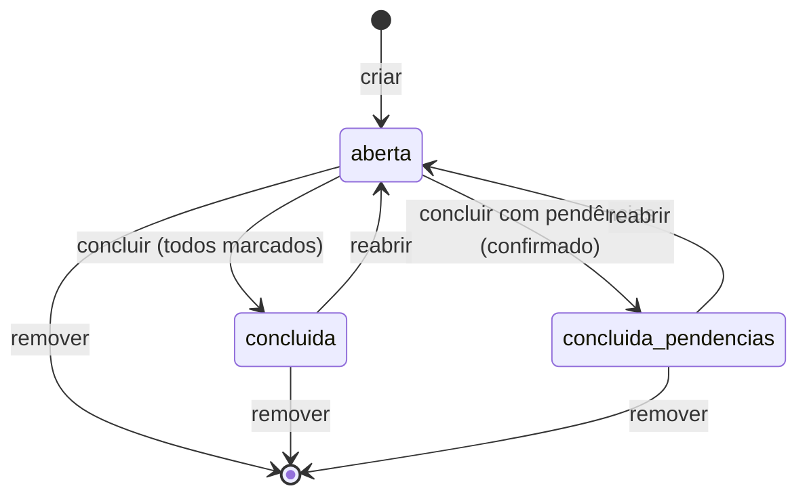

# Modelo de dados (Fase 1): Ordens de serviço com checklist offline

Todos os instantes são UTC em ISO 8601 com milissegundos (`2026-11-28T00:00:00.000Z`). Identificadores são UUID v4 em texto minúsculo.

## Entidades

### OS

| Campo | Tipo | Regra |
|---|---|---|
| `id` | texto (UUID) | Nasce na intenção de criar; único; imutável |
| `titulo` | texto | Obrigatório, 1 a 120 caracteres após `trim` |
| `cliente` | texto | Opcional, até 120 |
| `local` | texto | Opcional, até 200 (endereço) |
| `telefone` | texto | Opcional, até 30 |
| `observacoes` | texto | Opcional, até 2000 |
| `itens` | lista de Item | 1 a 100 itens; fixada na criação |
| `estado` | enumeração | `aberta`, `concluida`, `concluida_pendencias` |
| `criadaEm` | instante | Definido na criação |
| `atualizadaEm` | instante | Atualizado a cada efeito |
| `concluidaEm` | instante ou nulo | Preenchido na conclusão; nulo se aberta |
| `pendentes` | lista de identificadores de item | Só em `concluida_pendencias`; vazia nos demais |

Campos de texto livre da OS são imutáveis depois da criação (edição não está nos FR). Mudam só `itens[].marcado`, `estado`, `atualizadaEm`, `concluidaEm` e `pendentes`.

### Item de checklist

| Campo | Tipo | Regra |
|---|---|---|
| `id` | texto | `<osId>:<ordem>` com ordem de 1 a N; estável |
| `texto` | texto | 1 a 200 caracteres após `trim` |
| `marcado` | booleano | Estado, não alternância |

### Registro de auditoria

Esquema completo e invariantes em [contracts/audit-log.md](contracts/audit-log.md). Campos: `seq`, `ts`, `tentativa`, `acao`, `tipo`, `categoria`, `osId`, `itemId`, `pendentes`, `contagem`, `motivo`, `versaoApp`.

### Consentimento de armazenamento

| Campo | Tipo | Regra |
|---|---|---|
| `aceitoEm` | instante | Gravado junto com o registro `consentir` |
| `versaoTexto` | inteiro | Versão do texto do consentimento |
| `backend` | `idb` ou `ls` | Backend escolhido na inicialização |

### Meta

| Campo | Tipo | Regra |
|---|---|---|
| `rev` | inteiro | Começa em 0; soma 1 a cada commit; base do controle de revisão |
| `schema` | inteiro | Versão do formato (hoje 1) |

## Armazenamento físico

### IndexedDB `yby_os_checklist` (versão 1)

| Store | Chave | Conteúdo | Operações permitidas |
|---|---|---|---|
| `os` | `id` | OS | `put`, `delete` (inclusive remoção em massa) |
| `audit` | `seq` | Registro de auditoria | só `add` (PA-1) |
| `meta` | texto | `rev`, `schema`, `consent` | `put` |

### `localStorage` `yby_os_checklist_v1`

```text
{ "schema": 1, "rev": <int>, "consent": {...}, "os": { "<id>": OS, ... }, "audit": [ Registro, ... ] }
```

Validação ao carregar: `schema` conhecido, `rev` inteiro, `audit` com `seq` contínua de 1 a N, cada OS com `id` igual à chave. Qualquer falha impede a escrita e mostra erro; o app nunca sobrescreve um estado inválido.

## Transições de estado da OS



Regras:
- Marcar ou desmarcar item só vale com a OS `aberta`. Em OS concluída o app não oferece o controle; tentativa por defeito vira `recusa` com motivo `estado_invalido`.
- `concluir` com todos os itens marcados vai para `concluida`; com itens desmarcados exige confirmação e vai para `concluida_pendencias` com `pendentes` preenchido (D-5).
- `reabrir` limpa `concluidaEm` e `pendentes`.
- Repetir um comando que já está satisfeito vira `sem_efeito`.
- Remover é terminal para a OS e idempotente (D-7).
