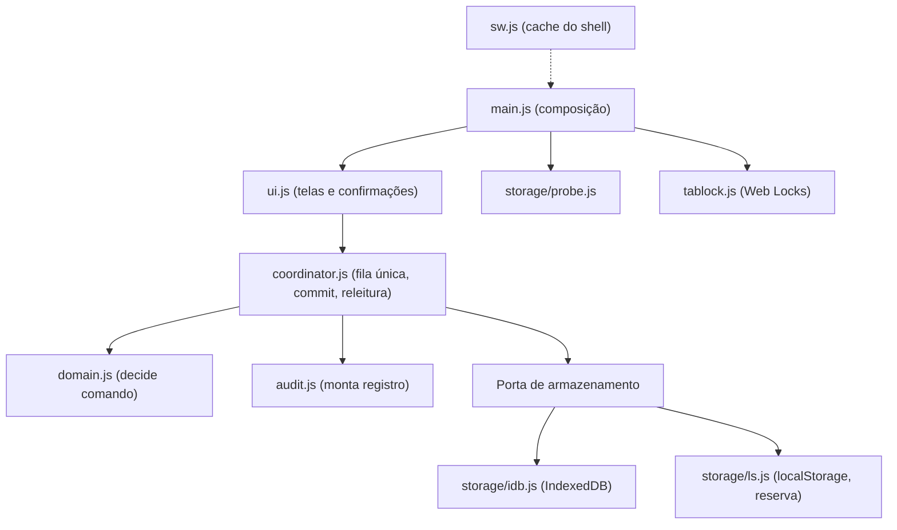
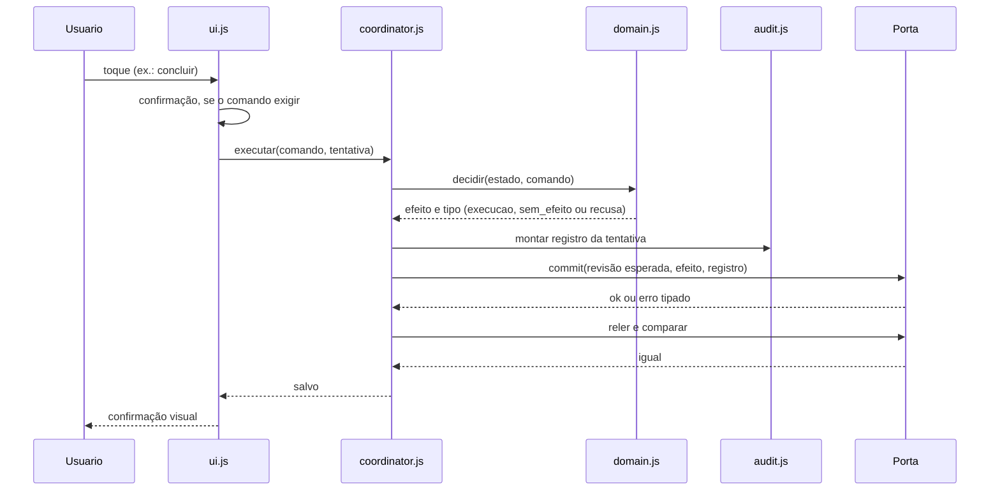

# Implementation Plan: Ordens de serviço com checklist offline

**Branch**: `cursor/plan-os-checklist-offline-e5da` | **Date**: 2026-11-28 | **Spec**: [spec.md](spec.md)

**Input**: Feature specification from `specs/001-os-checklist-offline/spec.md` (main em `0a4cc4a`, constituição 1.1.0).

**Note**: Este plano é documento. Nenhum código foi escrito. `tasks.md` só nasce em `/speckit-tasks`, com aprovação do mantenedor.

## Summary

Entregar um micro-app web offline (PWA estático, JavaScript puro em módulos ES, sem dependências novas) em `web/os-checklist/`, que cobre FR-001 a FR-014 e D-1 a D-7. O núcleo é um fluxo de escrita único: cada tentativa do usuário vira um comando; o domínio decide o resultado; uma única gravação atômica grava o estado e o registro de auditoria juntos; o app relê o que gravou e só então mostra "salvo".

Escolhas centrais, justificadas em [research.md](research.md):
- **Módulo novo, sem reaproveitar `src/yby_machine/compiler.py`**: o gerador atual grava primeiro em `localStorage`, engole erros e não audita, o que viola os Princípios III e IV e a regra S2.
- **Persistência**: IndexedDB como principal e `localStorage` como reserva (D-2, D-4), atrás de uma porta com duas implementações reais.
- **Testes sem dependência nova**: `node --test` para a lógica, Chrome headless opcional para IndexedDB real, e roteiro manual em A-Chrome e I-Safari.

### Premissas de auditoria (entrada obrigatória desta camada)

| ID | Premissa | Consequência no desenho |
|---|---|---|
| PA-1 | A remoção em massa não apaga o log de auditoria | O log é uma área separada do estado de OS; a porta de armazenamento só expõe `append` para ele, nunca `delete` nem `put`. |
| PA-2 | Recusas têm tipo próprio no log | Campo `tipo` com valor `recusa` (humana, com `motivo`), distinto de `execucao`, `sem_efeito` e `falha`. |
| PA-3 | A unidade de registro é a tentativa | Cada tentativa que chega ao domínio gera exatamente um registro, mesmo repetida ou sem efeito. Isso é coerente com FR-009 ("repetir uma ação idempotente registra a tentativa") e fixa a leitura de "ação" em SC-005 como tentativa. |

## Technical Context

**Language/Version**: JavaScript ES2022 (módulos nativos) para o app. Python 3.11 só para o teste-invólucro do pytest.

**Primary Dependencies**: nenhuma nova. Navegador (IndexedDB, `localStorage`, Web Locks, Service Worker, Blob). Ferramentas de desenvolvimento já presentes: Node 18 ou superior (`node --test`) e Chrome headless (opcional).

**Storage**: IndexedDB (`yby_os_checklist`, 3 stores: `os`, `audit`, `meta`) com reserva em `localStorage` (uma chave `yby_os_checklist_v1` com o estado completo). Sem backend.

**Testing**: `node --test` (lógica pura, porta falsa com injeção de falha), pytest invólucro (`tests/test_os_checklist_web.py`, pula se não houver Node), testes de navegador em Chrome headless (opt-in) e roteiro manual A-Chrome e I-Safari.

**Target Platform**: Android com Chrome e iPhone com Safari (iOS 16 ou superior, Chrome 90 ou superior). Origem segura (`localhost` ou HTTPS).

**Project Type**: web estático (PWA) dentro de um repositório Python; sem mudança no pacote `src/`.

**Performance Goals**: "salvo" em até 1 s no percentil 95 em celular intermediário, com até 200 OS. Abertura offline em até 2 s após a primeira carga.

**Constraints**: zero requisições de rede em uso; CSP restritiva; sem `innerHTML`; sem dado de usuário em URL, console ou cache; falha de auditoria bloqueia a ação (S2); reserva em `localStorage` limitada a cerca de 5 MB.

**Scale/Scope**: um técnico por aparelho, até 500 OS, até 100 itens por OS, até 10 mil registros de auditoria em modo reserva (limite maior no IndexedDB).

## Constitution Check

*GATE: passou antes da pesquisa (Fase 0) e foi reavaliado depois do desenho (Fase 1).*

| Regra | Avaliação | Evidência no plano |
|---|---|---|
| I. Function over Form | Passa | JavaScript puro, sem framework, UI mínima. A única abstração é a porta de armazenamento, com dois usos reais (IndexedDB e reserva). |
| II. Local-first e offline-first | Passa | Sem `fetch`, XHR, WebSocket nem beacon; CSP com `connect-src 'none'`; shell em cache pelo Service Worker. |
| III. Durabilidade explícita | Passa | Gravação atômica seguida de releitura; estados "salvando", "salvo" e erro; sem confirmação otimista. |
| IV. Idempotência | Passa | Identidade criada na intenção; marcação define estado; comandos repetidos viram `sem_efeito`; gravação atômica com controle de revisão. |
| V. Trava de escopo | Passa | Sem nuvem, sincronização, voz, wearables, visão, firmware nem importação. Multi-aba só bloqueia (D-3). |
| VI. Camadas pequenas | Passa | Seis camadas sugeridas (seção "Camadas sugeridas"), cada uma com aprovação própria. |
| S1. Confirmação antes de escrever ou enviar | Passa | Consentimento inicial único; confirmação por ação em exportar, remover uma OS, remover tudo e concluir com pendências. |
| S2. Auditoria | Passa, com adaptação | O registro é gravado na mesma transação do efeito: nenhum efeito sem registro. Falha de registro cancela o efeito. |
| S3. Firmware | Não se aplica | Sem firmware. |
| S4. Dados sensíveis locais | Passa | Auditoria só com enumerações e identificadores; dados só no aparelho; exportação só com confirmação. |
| Restrições técnicas | Passa | Nenhuma dependência nova; documentação só do que funciona (README entra na implementação). |
| Fluxo de desenvolvimento | Passa | Testes de durabilidade, repetição, recarga e interrupção na gravação estão no plano. |

**Complexity Tracking**: sem violações a justificar. Dois pontos de atenção estão nos riscos: o novo diretório `web/` e a dependência de Node e Chrome apenas como ferramentas de teste opcionais.

## Project Structure

### Documentation (this feature)

```text
specs/001-os-checklist-offline/
├── spec.md              # aprovado (PR #173)
├── plan.md              # este arquivo
├── research.md          # Fase 0: decisões e alternativas
├── data-model.md        # Fase 1: entidades, estados, validações
├── quickstart.md        # Fase 1: como rodar e validar
├── contracts/
│   ├── storage-port.md  # porta de armazenamento e erros
│   ├── audit-log.md     # esquema e invariantes do log
│   └── commands.md      # comandos do usuário, confirmações e resultados
└── checklists/requirements.md
```

### Source Code (repository root)

```text
web/os-checklist/
├── index.html               # shell, CSP, sem script inline
├── styles.css
├── manifest.webmanifest
├── sw.js                    # cache do shell por lista fixa
├── README.md                # só o que funciona hoje
├── src/
│   ├── main.js              # composição: sonda, consentimento, trava de aba, UI
│   ├── domain.js            # estados e decisão de cada comando (puro)
│   ├── audit.js             # monta e valida registros (esquema fechado)
│   ├── coordinator.js       # fila única, commit, releitura, estados de gravação
│   ├── storage/
│   │   ├── probe.js         # sonda IndexedDB sem criar banco; escolhe o backend
│   │   ├── idb.js           # porta com IndexedDB
│   │   └── ls.js            # porta com localStorage (reserva)
│   ├── tablock.js           # bloqueio da segunda aba (Web Locks)
│   ├── export.js            # monta o arquivo e entrega (download ou compartilhar)
│   └── ui.js                # DOM seguro, telas, confirmações
└── tests/
    ├── unit/*.test.mjs      # node --test (domínio, auditoria, coordenador, varredura estática)
    └── browser/harness.html # contrato da porta em Chrome headless (opt-in)

tests/test_os_checklist_web.py   # pytest: roda node --test; pula sem Node
```

**Structure Decision**: diretório novo `web/os-checklist/`, fora de `src/`, porque o app é estático e não faz parte do caminho Python do `ask`. Nenhum módulo existente é alterado (Princípio V e diff mínimo). Testes de lógica ficam junto do app; o invólucro pytest fica em `tests/` para entrar no `make test` sem mudar `Makefile` nem CI.

## Arquitetura

O app é uma aplicação de uma só aba, montada em quatro camadas com dependência em um só sentido: UI usa o coordenador; o coordenador usa o domínio, a auditoria e a porta; a porta tem duas implementações.



Princípios do desenho:
- **Domínio puro**: `domain.js` não conhece armazenamento nem relógio. Recebe o estado atual e um comando e devolve o resultado (efeito, tipo do registro, novo estado). Isso torna os Princípios III e IV testáveis em milissegundos.
- **Um caminho de escrita**: todo efeito passa por `coordinator.commit`. Não existe outro jeito de gravar.
- **Falha fechada**: sem consentimento, sem trava de aba, com snapshot corrompido ou com auditoria que não grava, o app não escreve.

## Componentes e módulos

| Módulo | Responsabilidade | Cobre |
|---|---|---|
| `domain.js` | Estados da OS (`aberta`, `concluida`, `concluida_pendencias`), validações e decisão por comando; calcula os pendentes | FR-005 a FR-007, D-5, D-7 |
| `audit.js` | Constrói o registro com esquema fechado e rejeita chaves desconhecidas e texto livre | FR-009, FR-011 |
| `coordinator.js` | Fila única de comandos, monta a transação, chama a porta, relê, publica os estados "salvando", "salvo" e erro | FR-003, FR-004, FR-008 |
| `storage/probe.js` | Descobre, sem criar banco, se já há dados e se o consentimento existe; escolhe IndexedDB ou reserva | FR-012, D-2, D-4 |
| `storage/idb.js` | Transação única sobre `os`, `audit` e `meta`, com controle de revisão | FR-003, PA-1 |
| `storage/ls.js` | Uma gravação de `setItem` por commit, releitura e verificação de cota | D-4 |
| `tablock.js` | Segura um bloqueio exclusivo durante a vida da aba; segunda aba recebe aviso | FR-013, D-3 |
| `export.js` | Monta o JSON de exportação e entrega por download ou compartilhamento do sistema, depois da confirmação e do registro | D-1, FR-012 |
| `ui.js` | Telas (lista, criar, detalhe, auditoria somente leitura, consentimento, aviso de reserva, aviso de segunda aba); DOM sem `innerHTML` | FR-001, FR-011 |
| `sw.js` | Cache do shell por lista fixa, sem cache de dado; atualização só no próximo início | FR-002 |
| `main.js` | Composição na ordem: trava de aba, sonda, consentimento, backend, carga, UI | todos |

## Fluxo de dados

Uma tentativa de escrita, do toque ao "salvo":



Regras do fluxo:
- Enquanto o commit está em andamento, o controle fica desabilitado e a tela mostra "salvando". Um novo toque só vira nova tentativa depois do commit.
- Se o commit falha, nada muda no armazenamento; o app tenta registrar a falha numa transação própria só de auditoria (tipo `falha`). Se isso também falhar, o usuário vê o erro e nada é gravado.
- Leitura de tela (listar, abrir, ver auditoria) lê a memória do coordenador, carregada do armazenamento no início. Não é leitura crítica (D-1).

## Persistência e idempotência

### Persistência (D-2, D-4, FR-003, FR-004, FR-008)

- **Escolha do backend** (uma vez, na inicialização): `probe.js` tenta abrir o IndexedDB sem criar banco (abortando em `onupgradeneeded` quando a versão antiga é 0). Se o IndexedDB abre, é o backend; se falha, entra a reserva com aviso permanente (D-4).
- **Sem divisão de dados**: se houver dados nos dois backends, o app para com mensagem clara. Não há migração nesta versão.
- **IndexedDB**: um commit é uma transação `readwrite` sobre `os`, `audit` e `meta`. Ou tudo grava ou nada grava, inclusive na interrupção do navegador. Depois, uma transação `readonly` relê o registro de OS e o registro de auditoria e compara.
- **Reserva em `localStorage`**: o estado inteiro (revisão, consentimento, OS e auditoria) fica numa chave só. Cada commit faz um `setItem` e relê com `getItem`. Erro de cota é mostrado ao usuário e nada é dado como salvo.
- **Estado carregado inválido** (versão desconhecida, JSON quebrado): o app recusa iniciar a escrita e nunca sobrescreve.
- **Controle de revisão**: o commit informa a revisão que leu; se a revisão guardada for outra, o commit é recusado. Com aba única e fila única isso só dispara por defeito, e vira erro visível.
- **Persistência pedida ao navegador**: o app chama `navigator.storage.persist()` depois do consentimento e avisa quando o navegador nega. No iPhone, dados de sites sem uso podem ser removidos; o aviso e a exportação são o plano de contingência (FR-014).

### Idempotência (FR-005, FR-006, FR-007, FR-008)

| Comando | Regra | Repetição |
|---|---|---|
| `criar` | O identificador da OS nasce quando o formulário abre; o commit grava só se o identificador não existir | `sem_efeito`, nunca segunda OS |
| `definirItem(osId, itemId, marcado)` | Define o estado (não alterna); só vale em OS aberta | Mesmo valor vira `sem_efeito`; itens têm identificador fixo, sem duplicação |
| `concluir` | `concluida` ou `concluida_pendencias` conforme os itens; guarda o instante e os pendentes | Já concluída vira `sem_efeito`, sem alterar estado nem instante |
| `reabrir` | Volta para `aberta` | Já aberta vira `sem_efeito` |
| `removerOs` | Remove a OS e seus itens | OS inexistente vira `sem_efeito` |
| `removerTudo` | Remove todas as OS; o log permanece (PA-1) | Sem OS vira `sem_efeito` |

Interrupção no meio de uma gravação: o estado fica no anterior completo ou no novo completo, porque a transação do IndexedDB e o `setItem` único são atômicos. Recarregar durante a criação deixa zero ou uma OS.

## Auditoria

Detalhes em [contracts/audit-log.md](contracts/audit-log.md). Resumo:

- **Somente de acréscimo (PA-1)**: a porta expõe `append` para o log, sem `put` nem `delete`. A remoção em massa apaga só o armazenamento de OS. No `localStorage`, o código só adiciona ao fim do vetor e confere a sequência.
- **Tipo próprio para recusas (PA-2)**: cada registro tem `tipo` com um destes valores: `execucao`, `sem_efeito`, `recusa`, `falha`. A recusa humana (cancelou uma confirmação) é `recusa` com `motivo`. Recusa por estado inválido também é `recusa`, com motivo próprio. A única recusa fora do log é a do consentimento inicial (exceção declarada abaixo).
- **Unidade = tentativa (PA-3)**: cada registro tem `tentativa` (identificador). Duplo toque sem efeito gera dois registros: um `execucao` e um `sem_efeito`. A contagem do roteiro compara tentativas com registros.
- **Sem valor sensível (S4, FR-011)**: campos fechados (enumerações, identificadores, contagens, instante UTC). Os itens pendentes entram como identificadores, nunca como texto (D-5).
- **Efeito e registro juntos (S2, FR-009)**: o registro vai na mesma transação do efeito. Se o registro não grava, o efeito não acontece.
- **Exceção declarada**: a recusa do consentimento inicial não é gravada, porque D-2 e SC-006 exigem zero bytes antes do consentimento. O aceite grava o consentimento e o registro `consentir` na mesma transação.
- **Exportação** grava o registro antes de entregar o arquivo. O registro significa "entregue ao navegador"; o app não sabe se o usuário concluiu o compartilhamento.
- **Tela de auditoria**: lista somente leitura (tipo, ação, instante, identificador da OS) para o roteiro de validação.

## Segurança e confirmação

### Confirmação humana (R-12, S1, D-2, D-5, D-7)

| Ação | Confirmação | Resumo mostrado | Se recusar |
|---|---|---|---|
| Primeira execução | Única, antes de qualquer gravação | O que grava, onde (no aparelho, sem envio), qual backend | Nada é gravado |
| Exportar ou compartilhar | Por ação | Número de OS e itens, tamanho aproximado | Registro `recusa` |
| Remover uma OS | Por ação | Título e número de itens | Registro `recusa` |
| Remover tudo | Por ação | Número de OS e itens | Registro `recusa` |
| Concluir com pendências | Alerta com lista de pendentes | Itens pendentes | Registro `recusa`; OS continua aberta |

Detalhes e resultados esperados em [contracts/commands.md](contracts/commands.md).

### Dados sensíveis (R-11, S4)

- Dados só no armazenamento do aparelho; sem `fetch`, XHR, WebSocket, beacon nem recurso externo.
- CSP no `index.html`: `default-src 'none'`, `script-src 'self'`, `style-src 'self'`, `img-src 'self' data:`, `manifest-src 'self'`, `worker-src 'self'`, `connect-src 'none'`, `base-uri 'none'`, `form-action 'none'`.
- Sem `innerHTML` e sem script inline. Todo texto do usuário entra por `textContent`.
- Sem dado de usuário na URL (a rota usa só o identificador aleatório da OS) nem no console (varredura estática proíbe `console.` nos módulos).
- O Service Worker guarda só a lista fixa de arquivos do shell, nunca respostas dinâmicas.
- Nenhum segredo, chave ou credencial no repositório; varredura de padrões de segredo entra no teste estático.

### Trava de escopo (R-13, Princípio V)

- Sem login, sincronização, importação (D-6), voz, wearables, visão nem firmware. A varredura estática confirma que os módulos não contêm rede nem entrada de arquivo.
- Segunda aba (D-3): `tablock.js` pede um bloqueio exclusivo com `ifAvailable`. Quem não obtém o bloqueio mostra "App já aberto em outra aba" e não monta a UI de escrita. Sem Web Locks no navegador, o app também bloqueia, com aviso de navegador sem suporte (falha fechada).

## Testes e validação

### Camadas de teste

| Camada | Ferramenta | Roda no `make test` | O que prova |
|---|---|---|---|
| Lógica pura | `node --test` com porta falsa e injeção de falha | Sim (pula se não houver Node) | Estados, idempotência, auditoria, recusas, fila única, "salvo" só depois da releitura, interrupção no commit, esquema do log sem dado sensível |
| Varredura estática | `node --test` sobre os fontes | Sim | Sem rede, sem `innerHTML`, sem `console.`, sem segredo, CSP presente |
| Contrato da porta em navegador | Chrome headless, `harness.html` | Não (opt-in com `YBY_OS_BROWSER_TESTS=1`) | IndexedDB e `localStorage` reais cumprem o mesmo contrato, incluindo atomicidade, cota simulada e bloqueio de aba |
| Roteiro em aparelho | Manual | Não | FR-001 a FR-014 e D-5 a D-7 em A-Chrome e I-Safari |

### Mapa de cobertura

| Requisito | Lógica | Navegador headless | A-Chrome e I-Safari |
|---|---|---|---|
| FR-001, FR-002 | varredura estática | cache do shell | modo avião, reabertura e ícone na tela inicial |
| FR-003, FR-004 | porta falsa com falha | IDB e LS reais | cota cheia, "salvando" e "salvo" |
| FR-005 a FR-007 | domínio e coordenador | duplo commit | duplo toque, recarga, reabertura |
| FR-008 | falha no meio do commit | transação abortada | encerrar o navegador logo após marcar |
| FR-009 | auditoria e recusas | append-only | contagem de tentativas igual à de registros |
| FR-010, FR-011 | varredura estática | CSP | proxy na rede, inspeção do armazenamento |
| FR-012, D-7 | recusa e cancelamento | consentimento | recusar na primeira execução; cancelar remoções |
| FR-013, D-6 | varredura estática | duas abas em iframes | duas abas reais |
| FR-014, D-5 | conclusão com pendências | n/a | roteiro completo e dados removidos por inatividade no Safari |

O roteiro passo a passo e o formato do registro de resultados estão em [quickstart.md](quickstart.md). O resultado por requisito e por aparelho é guardado em `specs/001-os-checklist-offline/validation/` durante a camada de validação.

### Camadas sugeridas para `/speckit-tasks` (Princípio VI)

1. Domínio e auditoria puros, com testes de lógica.
2. Porta, coordenador e porta falsa, com testes de durabilidade e idempotência.
3. Adaptadores IndexedDB e reserva, com testes de navegador.
4. UI, consentimento, confirmações, exportação e bloqueio de segunda aba.
5. Shell PWA offline: Service Worker, manifesto, CSP e README.
6. Validação em aparelhos reais e registro dos resultados.

## Riscos e mitigações

| Risco | Impacto | Mitigação |
|---|---|---|
| iPhone só registra Service Worker em origem segura; `http` na rede local não serve | Sem FR-002 e FR-014 em I-Safari | Validar em HTTPS. Decisão aberta D-A abaixo. Android usa `localhost` por `adb reverse`. |
| Safari remove dados de sites sem uso e separa o armazenamento do app instalado do da aba | Perda de dados ou dois conjuntos de dados | Pedir persistência, avisar quando negada, orientar a instalar na tela inicial e exportar. Cobrir no roteiro I-Safari. |
| Reserva em `localStorage` limitada a cerca de 5 MB e o log só cresce | Em modo reserva o app pode parar por cota | Aviso a 80% de uso, erro claro na cota (falha fechada), capacidade estimada em 500 OS e 10 mil registros. IndexedDB tem folga. |
| S2 diz "registro antes"; o plano grava juntos | Leitura literal da regra | Garantia equivalente: nenhum efeito sem registro e nenhum efeito se o registro falhar. Documentado na verificação da constituição. |
| Registro `exportar` significa "entregue ao navegador" | Não prova que o arquivo chegou ao destino | Documentar a limitação; o roteiro confere o arquivo gerado. |
| Web Locks pode soltar o bloqueio com a página congelada em segundo plano (iOS) | Aba reaberta lê estado antigo | O coordenador revalida a revisão ao voltar ao primeiro plano e recarrega se mudou. Cobrir no roteiro. |
| Dois backends com dados | Divisão de dados | Parar com mensagem clara; sem migração nesta versão. |
| SC-005 diz "cada ação" e PA-3 fixa "por tentativa" | Leitura ambígua de "ação" | FR-009 já cobre a repetição; opcionalmente um esclarecimento de uma linha na spec, em PR próprio. |
| Chrome e Node como ferramentas de teste | Ambiente sem eles | Testes de lógica pulam sem Node; testes de navegador são opt-in; nenhuma dependência entra no `requirements*.txt`. |

### Decisões abertas para o mantenedor (não bloqueiam `/speckit-tasks`)

- **D-A. Hospedagem HTTPS para validar no iPhone**: padrão proposto é uma hospedagem estática só do código (sem dado de usuário), com deploy aprovado à parte. Alternativa: HTTPS local com certificado confiável no aparelho.
- **D-B. Testes de navegador**: padrão proposto é opt-in (`YBY_OS_BROWSER_TESTS=1`), fora do `make test`, para não tornar o CI instável. Alternativa: incluir no CI.
- **D-C. Chave de diagnóstico `?storage=ls`**: padrão proposto é incluí-la, documentada e com o aviso de reserva visível, para exercitar a reserva em aparelho real (o modo privado do Safari atual aceita IndexedDB). Alternativa: sem chave, reserva só em teste headless.
